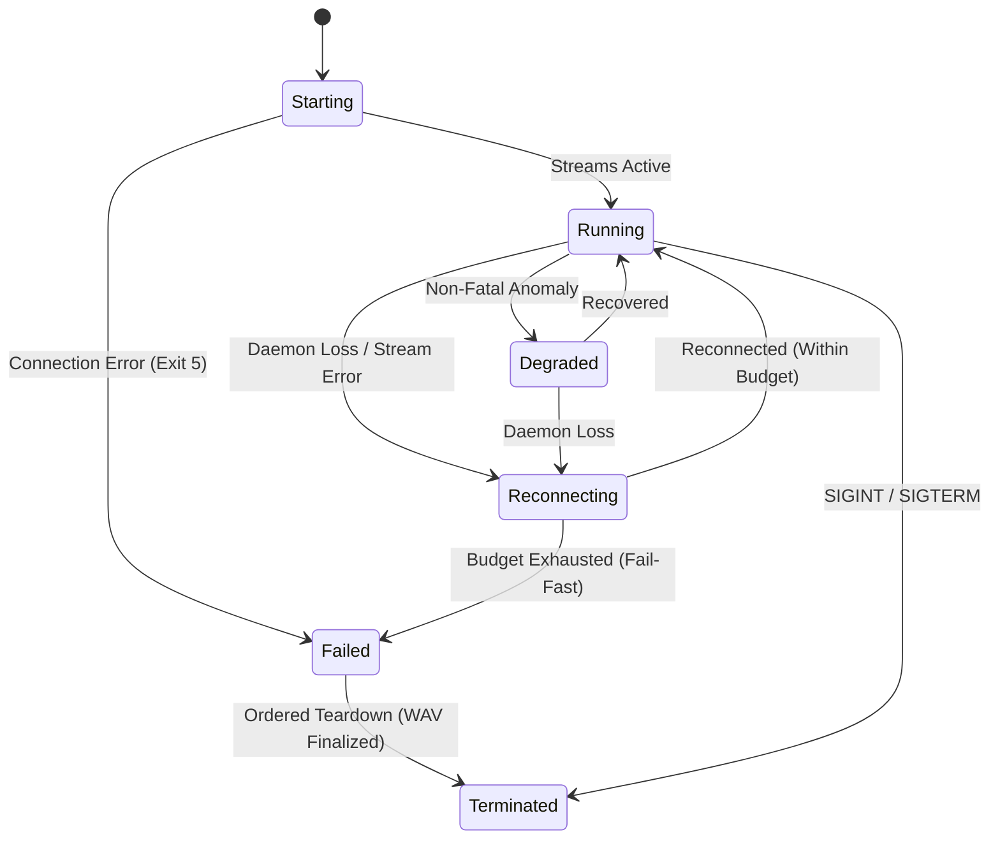

<!--
SPDX-License-Identifier: GPL-3.0-or-later
Copyright (c) 2026 Fábio Henrique de Lima Silva (fhl.bsb@gmail.com) All rights reserved.
-->

# NAM-Audio-Pipe Architecture: Low-Latency PipeWire Host

This document serves as the technical architecture reference and system specification for **NAM-Audio-Pipe**, a low-latency, real-time standalone audio host for [Neural Amp Modeler (NAM)](https://www.neuralampmodeler.com/) simulation on Linux using native PipeWire multimedia graphs.

NAM-Audio-Pipe embeds [`NeuralAmpModeler-rs`](https://github.com/fabiohl/NeuralAmpModeler-rs) as its core DSP engine, providing complete model execution (WaveNet, LSTM, ConvNet, Linear), cabinet impulse response (IR) convolution, polyphase sample rate conversion, and anti-aliasing oversampling.

> **Core Philosophy**: Source code is the primordial source of truth. This document defines the high-level system topology, threading model, memory layout, real-time safety contracts, and external system integrations that cannot be expressed within code comments alone.

---

## 1. System Topology & Dual-Stream PipeWire Architecture

In PipeWire's multimedia graph, an audio capture sink (`Audio/Sink`) processes incoming signals, but its monitor port delivers audio *before* DSP processing. To route processed sound to hardware playback devices or patchbays without creating feedback loops, NAM-Audio-Pipe implements a **dual-stream architecture** coupled through an internal lock-free shared memory bridge:

```text
┌─────────────────────────────────────────────────────────────────────────────┐
│                           PipeWire Multimedia Graph                         │
└──────┬──────────────────────────────────────────────────────────────▲───────┘
       │ Audio Input (Guitar DI / Mic)                                │ Processed Output
       ▼                                                              │
┌──────────────────────────────┐              ┌───────────────────────────────┐
│     Capture Stream / Node    │              │    Playback Stream / Node     │
│   (NAM-Audio-Pipe-input)     │              │   (NAM-Audio-Pipe-playback)   │
│   - Node: "Audio/Sink"       │              │   - Node: "Stream/Output"     │
│   - Group: "nam-audio-pipe"  │              │   - Group: "nam-audio-pipe"   │
│   - Runs DSP on Audio Thread │              │   - Reads from DspBridge      │
└──────────────┬───────────────┘              └───────────────▲───────────────┘
               │                                              │
               │ (process_dsp)                                │ (on_process)
               ▼                                              │
       ┌──────────────────────────────────────────────────────────────┐
       │                   DspBridge (Shared Memory)                  │
       │  - Double-Buffered Scratch Arrays (buf_l, buf_r)             │
       │  - Lock-Free Atomic Read/Write Generation Synchronization    │
       │  - madvise(MADV_DONTFORK | MADV_DONTDUMP)                    │
       │  - #[repr(align(128))] Cache-Line Isolation                  │
       └──────────────────────────────┬───────────────────────────────┘
                                      │
                                      │ (If --record active)
                                      ▼
                       ┌──────────────────────────────┐
                       │   SPSC Recording Pool        │
                       │    (Descriptor / 64 KiB Slot)│
                       └──────────────┬───────────────┘
                                      │
                                      ▼
                       ┌──────────────────────────────┐
                       │  Disk I/O Worker Thread      │
                       │   - tokio-uring (io_uring)   │
                       │   - Async 32-bit Float WAV   │
                       │   - 4 GiB RIFF Auto-Split    │
                       └──────────────────────────────┘
```

### 1.1 Registered Nodes & Stream Identity

All PipeWire node names, stream descriptions, and thread loop identifiers are defined as typed constants in [`src/standalone/pw_host/identity.rs`](../src/standalone/pw_host/identity.rs):

| PipeWire Entity     | Registered Node Name      | Node Description                  | Media Class / Role                            | Constant in `identity.rs`                         |
|:------------------- |:------------------------- |:--------------------------------- |:--------------------------------------------- |:------------------------------------------------- |
| **Capture Node**    | `NAM-Audio-Pipe-input`    | `NAM-Audio-Pipe Input`            | `Audio/Sink` (Virtual capture sink)           | `PW_CAPTURE_NODE_NAME` / `PW_CAPTURE_NODE_DESC`   |
| **Capture Stream**  | `NAM-Audio-Pipe`          | Primary capture audio stream      | Receives incoming hardware/application audio  | `PW_CAPTURE_STREAM_NAME`                          |
| **Playback Node**   | `NAM-Audio-Pipe-playback` | `NAM-Audio-Pipe Processed Output` | `Stream/Output/Audio` (Audio playback source) | `PW_PLAYBACK_NODE_NAME` / `PW_PLAYBACK_NODE_DESC` |
| **Playback Stream** | `NAM-Audio-Pipe-Output`   | Processed audio output stream     | Emits processed audio to hardware/patchbay    | `PW_PLAYBACK_STREAM_NAME`                         |

### 1.2 Graph Scheduling Synchronization

To eliminate inter-thread synchronization jitter, both streams are bound to identical scheduling groups:

- `node.group = "nam-audio-pipe-dsp"` (`PW_NODE_GROUP`)
- `node.link-group = "nam-audio-pipe-link-group"` (`PW_LINK_GROUP`)

This configuration instructs the PipeWire graph scheduler to execute both capture and playback callbacks synchronously on the same real-time driver loop thread (`nam-audio-pipe-loop`, `PW_THREAD_LOOP_NAME`).

---

## 2. Memory Architecture & Lock-Free Bridge (`DspBridge`)

The shared memory bridge ([`src/standalone/pw_host/bridge.rs`](../src/standalone/pw_host/bridge.rs)) coordinates zero-copy, lock-free audio transfer between the capture callback (which executes neural inference) and the playback callback (which copies processed buffers to hardware output).

```text
┌─────────────────────────────────────────────────────────────────────────────┐
│                          DspBridge Memory Layout                            │
├─────────────────────────────────────────────────────────────────────────────┤
│  #[repr(align(128))] buffers: [BridgeBuffer; 2]                             │
│    - BridgeBuffer 0: buf_l: [f32; 8192], buf_r: [f32; 8192], n_samples: u32 │
│    - BridgeBuffer 1: buf_l: [f32; 8192], buf_r: [f32; 8192], n_samples: u32 │
├─────────────────────────────────────────────────────────────────────────────┤
│  active_read_idx: AtomicUsize                                               │
│  generation:      AtomicU64                                                 │
│  consumed_gen:    AtomicU64                                                 │
│  dropped_frames:  AtomicU32                                                 │
└─────────────────────────────────────────────────────────────────────────────┘
```

### 2.1 Double Buffering & Cache Isolation

- **Zero-Copy Double Buffering**: `DspBridge` contains two independent `BridgeBuffer` slots (`MAX_BRIDGE_BUF = 8192` samples). The capture stream writes to `buffers[1 - active_idx]` and flips `active_read_idx` using `Ordering::Release`. The playback stream loads `active_read_idx` using `Ordering::Acquire` and reads without mutex locks.
- **Cache-Line Isolation (`#[repr(align(128))]`)**: The structure is aligned to 128 bytes to isolate cache lines and prevent CPU cache-line bouncing (false sharing) between threads.
- **Page Alignment & Kernel Advisories**: Allocated dynamically with a 4096-byte page-aligned layout and wrapped in `BridgeRef`. Applies Linux memory flags:
  - `madvise(MADV_DONTFORK)`: Eliminates Copy-on-Write duplication overhead if child processes are spawned.
  - `madvise(MADV_DONTDUMP)`: Excludes large scratch buffers from core dumps to conserve disk space during debugging.

---

## 3. Threading Model & Hard Real-Time Contracts

NAM-Audio-Pipe enforces strict thread segregation across three isolated execution domains:

```text
┌─────────────────────────────────────────────────────────────────────────────┐
│                                Main Thread                                  │
│  - CLI Parsing & Model/IR Loading                                           │
│  - PipeWire Initialization & Shutdown Lifecycle                             │
│  - Off-RT Resampler / CabSim Dynamic Rebuilds                               │
│  - Housekeeping & SPSC Garbage Collection Drain (drain_gc_channels)         │
│  - Telemetry Polling (poll_rt_status @ 10 Hz)                               │
└──────┬──────────────────────────────┬───────────────────────────────┬───────┘
       │                              │                               │
       │ SPSC Command Channels        │ Atomic Telemetry              │ SPSC Audio Ring
       ▼                              ▼                               ▼
┌─────────────────────────────┐┌──────────────────────────────┐┌──────────────┐
│  Audio Thread (RT Callback) ││       RtStatusFlags          ││ Recording I/O│
│  - PipeWire thread_loop     ││  - Sample Rate & Latency     ││  - tokio-uring│
│  - Strict RT Safety Contract││  - CPU Cycles per Quantum    ││  - Async Disk│
│  - Neural Inference & DSP   ││  - Gate State & Overloads    ││  - Idle Sleep│
└─────────────────────────────┘└──────────────────────────────┘└──────────────┘
```

### 3.1 Hard Real-Time Safety Contracts (Audio Thread)

The audio processing callback executes under strict real-time determinism:

1. **Zero Heap Allocations**: All scratch buffers, resamplers, layer weights, and convolution engines are pre-allocated during startup or swapped via SPSC pointers.
2. **Zero Mutex Locks**: Inter-thread coordination uses wait-free SPSC channels (`rtrb`) and atomic memory primitives.
3. **Zero Blocking I/O**: Filesystem access, standard output printing, and direct logging macros (`log::*`) are prohibited in the audio callback.
4. **Panic Containment**: Callback bodies are wrapped in `catch_unwind(AssertUnwindSafe)`. Unhandled panics latch the fatal atomic flag `RT_STATUS_PANIC_CAPTURED` and mute output, allowing the main control loop to initiate a graceful shutdown instead of aborting the process.

---

### 3.2 Backend State Machine, Fail-Fast SLA & Bounded Reconnect

The PipeWire host lifecycle is governed by a thread-safe backend state machine ([`src/standalone/pw_host/status.rs`](../src/standalone/pw_host/status.rs)):



#### Key Lifecycle Invariants

- **Sticky Failure**: Once marked `Failed`, the state cannot revert to `Running` except through a formal reconnection handshake (`begin_reconnect`). The main control loop polls this status via an atomic fast-path, initiating teardown within 200 ms (fail-fast SLA < 500 ms).
- **DSP State Preservation**: `CaptureState` (neural models, resamplers, cabinet IRs, gains) and RT-side SPSC channels reside in heap `Box` allocations reached via raw pointers outside stream closures. Re-instantiating PipeWire streams after a daemon restart preserves all internal processing state.
- **Bounded Reconnect Budget**:
  - Production default: 6 attempts with progressive exponential backoff (250 → 500 → 1000 → 2000 → 4000 → 4000 ms), capped at an 11.75-second ceiling per episode.
  - When `--fail-fast` is passed, reconnection is disabled entirely.
  - `--reconnect-timeout <s>` allows operators to tune the total budget.
- **Stability Window Reset (60 s)**: After 60 seconds (`STABLE_RESET`) of uninterrupted healthy streaming, the attempt budget is fully replenished. Transient drops over prolonged sessions never accumulate to trigger an unintended process exit.

---

### 3.3 Termination Signal Handling & Grace Windows

Process termination is unified in [`src/standalone/signals.rs`](../src/standalone/signals.rs):

- **Signal Interception**: Installs an async-signal-safe handler for `SIGINT` (Ctrl+C), `SIGTERM` (systemd/containers), `SIGHUP` (terminal window closure), and `SIGQUIT`.
- **Atomic Grace Window**:
  - The first signal sets the process-global `SHUTDOWN` atomic flag and initiates cooperative teardown.
  - Normal grace window is 500 ms; when recording is active, `main()` extends this window to 5,000 ms (`RECORDING_GRACE_WINDOW_MS`) to allow in-flight WAV headers to rewrite and flush cleanly (`fsync`).
  - Signals arriving within the grace window are ignored to avoid interrupting cleanup. Signals arriving *after* the window expires escalate to `_exit(1)`.
- **Broken Pipe Handling**: CLI outputs (`--help`, `--diagnose`) use `cli::write_stdout`, which tolerates `EPIPE` when piped to pagination utilities (`head -n 1`) without panicking.
- **Color Discipline**: ANSI escape sequences are automatically disabled when standard output is redirected to files or pipes, respecting `NO_COLOR` and `CLICOLOR_FORCE`.

---

### 3.4 Runtime Error Taxonomy & Exit Codes

Failures are categorized into distinct exit codes ([`src/standalone/exit.rs`](../src/standalone/exit.rs)) to facilitate script automation:

| Exit Code | Classification   | Trigger Conditions                                              | User Remediation Hint                                |
|:---------:|:---------------- |:--------------------------------------------------------------- |:---------------------------------------------------- |
|   **0**   | Clean Success    | Normal process termination via signal or `--help`/`--diagnose`. | None (operation completed successfully).             |
|   **1**   | Generic / Forced | Uncategorized failure or hard signal escalation after timeout.  | Inspect application error logs.                      |
|   **2**   | Argument Error   | Malformed CLI flags, invalid buffer size, or missing files.     | Run with `-h` or `--help` to review syntax.          |
|   **3**   | Model Load Error | Corrupt, missing, or unsupported `.nam`/`.namb` file format.    | Verify model file path and architecture support.     |
|   **4**   | Cabinet IR Error | Unreadable or malformed cabinet impulse response `.wav` file.   | Check IR file format or pass `--cab-optional`.       |
|   **5**   | Backend Error    | Unreachable PipeWire daemon or stream negotiation failure.      | Verify PipeWire daemon status (`systemctl --user`).  |
|   **6**   | Recording Error  | Unwritable directory, `io_uring` failure, or buffer overruns.   | Check disk permissions and space availability.       |

---

## 4. Linux Real-Time & Kernel Tuning Layer (`rt_setup`)

To guarantee glitch-free audio processing at quantum sizes down to 64 samples (1.33 ms deadline at 48 kHz), NAM-Audio-Pipe integrates with the engine's canonical `neural_amp_modeler_rs::rt_hardening` infrastructure ([`src/standalone/rt_setup/`](../src/standalone/rt_setup/)):

### 4.1 CPU Core Affinity & Housekeeping Confinement

- **Optimal Core Selection**: Automatically inspects CPU topology (`/sys/devices/system/cpu/`) and streaming `/proc/interrupts` data to identify isolated, non-boot CPU cores with minimal IRQ load.
- **Housekeeping Confinement**: Binds auxiliary threads (main control loop, recording worker, PipeWire driver loop) to housekeeping cores, leaving the dedicated real-time core exclusive to audio processing.
- **IRQ Advisories**: Issues warnings if device interrupt vectors share the selected audio core.

### 4.2 Power Management QoS & Memory Locking

- **PM QoS (`/dev/cpu_dma_latency`)**: Pins CPU DMA latency to 0 µs, preventing power management from transitioning execution cores into deep sleep states (C-states: C1, C6, C8).
- **Memory Paging Lock (`mlockall`)**: Locks the application's virtual address space into physical RAM (`MCL_CURRENT | MCL_FUTURE`), preventing page faults and swap disk I/O.
- **Transparent Huge Pages (THP) Disablement**: Disables THP via `prctl(PR_SET_THP_DISABLE, ...)` to prevent kernel compaction daemon (`khugepaged`) latency spikes.
- **Hardware Sink Auto-Detection**: Queries `pw-metadata` with a 500 ms watchdog timeout to locate the default audio output sink, filtering out loopback nodes to prevent routing feedback.

### 4.3 Host Calibration Guidelines (Kernel Command Line)

For production deployment on dedicated low-latency machines, configure `/etc/default/grub` with core isolation parameters (example for dedicated core 8 and SMT sibling 9 on a 16-thread CPU):

```text
GRUB_CMDLINE_LINUX_DEFAULT="isolcpus=managed_irq,domain,8,9 nohz_full=8,9 rcu_nocbs=8,9 irqaffinity=0-7,10-15 nmi_watchdog=0 skew_tick=1"
```

```bash
# Recommended host preparation commands:
echo 0 | sudo tee /sys/devices/system/cpu/cpu9/online                 # Disable hyperthreaded sibling
echo performance | sudo tee /sys/devices/system/cpu/cpu*/cpufreq/scaling_governor
echo 0 | sudo tee /sys/devices/system/cpu/cpufreq/boost              # Eliminate dynamic boost jitter
ulimit -r 95                                                         # Grant RT FIFO scheduling
ulimit -l unlimited                                                  # Grant physical memory locking
```

---

## 5. Lock-Free SPSC Channels & 3-Tier GC Cascade

Communication between the non-RT main thread and the real-time audio thread is coordinated through bounded single-producer single-consumer (`rtrb`) queues:

```text
┌─────────────────────────────────────────────────────────────────────────────┐
│                           SPSC Channel Topology                             │
├─────────────────────────────────────────────────────────────────────────────┤
│  param_channel:     Consumer<ParamPayload>       (Gains, Bypass, Modes)     │
│  resampler_channel: Consumer<Box<NamResampler>>  (Off-RT Rebuilt Resamplers)│
│  cabsim_channel:    Consumer<Option<Box<CabSimPair>>> (Off-RT Rebuilt IRs)  │
│  slimmable_channel: Consumer<Option<Box<StaticModel>>> (A2 Submodels)       │
│  os_channel:        Consumer<Box<OsEnginePair>>  (Oversampling Engines)     │
│  gc_channel:        Producer<GcItem>             (Replaced Asset Dealloc)   │
└─────────────────────────────────────────────────────────────────────────────┘
```

### 5.1 Three-Tier Garbage Collection Cascade

When models, resamplers, or impulse responses are replaced during playback, dropping complex heap structures directly on the audio thread would trigger allocator locks. Deallocation cascades through three tiers:

```text
RT Thread (Replaced Asset)
       │
       ▼
[Tier 1: SPSC gc_tx (32 slots)] ──────► Drained by Main Thread (10 Hz poll)
       │ (if full)
       ▼
[Tier 2: RT Parking Lot (16 slots)] ──► Flushed to SPSC on next block;
       │                                Single-owner handoff on shutdown
       │ (if full)
       ▼
[Tier 3: GcOverflowBuffer Atomic Ring] ──► Controlled Leak + Sets RT_STATUS_GC_OVERFLOW
```

1. **Tier 1 (SPSC GC Queue)**: Discarded assets are pushed to `gc_tx` (32 slots) and deallocated by the main thread during its 10 Hz poll (`drain_gc_channels`).
2. **Tier 2 (RT Parking Lot)**: If the queue is momentarily full, items are stored in a fixed array on the RT thread (`PARKING_LOT_CAPACITY = 16`) and retried on subsequent blocks.
3. **Tier 3 (GC Overflow Buffer)**: If both tiers are saturated, items are deposited into an atomic overflow ring with controlled leak semantics, raising the diagnostic flag `RT_STATUS_GC_OVERFLOW`.

---

## 6. DSP Pipeline & Quantum Bounds

The core processing pipeline executes neural simulation and cabinet filtering across incoming audio blocks:

```text
Audio Input (PipeWire)
       │
       ▼
[Capture Ring / Channel Split] ──► [Input Gain Stage]
                                          │
                                          ▼
                                   [Noise Gate / Envelope]
                                          │
                                          ▼
                                   [Neural Model (NAM Core)]
                                          │
                                          ▼
                                   [CabSim (UPOLS Partitioned FFT)]
                                          │
                                          ▼
                                   [Output Gain Stage]
                                          │
                                          ▼
                                  [Playback Bridge] ──► Audio Output (PipeWire)
```

### 6.1 Static Buffer Limits & Negotiation

To guarantee deterministic memory bounds, all components enforce strict maximum limits:

| Constant / Limit       | Boundary Constraint               | Architectural Enforcement                                                         |
|:---------------------- |:--------------------------------- |:--------------------------------------------------------------------------------- |
| `MAX_BRIDGE_BUF`       | 8192 samples                      | `DspBridge` width; callbacks reject larger descriptors fail-closed.               |
| `MAX_RESAMP_BUF`       | 8192 samples                      | Bounds maximum memory allocation for resamplers and oversampling engines.         |
| CabSim Partition Size  | Clamped to `[16, MAX_RESAMP_BUF]` | Rebuild handlers clamp requested partitions before constructing UPOLS FFT plans.  |
| `--buffer-size` Domain | `{0} ∪ {2^k \| 16 ≤ 2^k ≤ 8192}`  | Validated at CLI parsing; invalid values reject before PipeWire graph connection. |

### 6.2 Real-Time Watchdog & Dynamic Downgrade

If DSP processing time exceeds 80% of the quantum deadline (`DEADLINE_EXCEEDED`), the engine transitions to a degraded state (`DEGRADE`), swapping to a lightweight A2 submodel via SPSC channels to prevent audible dropouts. When CPU contention subsides, full processing is automatically restored.

---

## 7. Asynchronous WAV Recording Subsystem (`src/recording/`)

When launched with `--record`, NAM-Audio-Pipe captures 32-bit float stereo WAV files without impacting real-time determinism:

```text
┌─────────────────────────────────────────────────────────────────────────────┐
│                           Recording Architecture                            │
├─────────────────────────────────────────────────────────────────────────────┤
│  Audio Thread (RT)                                                          │
│    - Checks gate state (pass-through when gate is off)                      │
│    - Audio: try_acquire() slot → fill_planar in place → publish()           │
│      (preallocated pool, 4-byte descriptor; zero allocation on RT)          │
│    - Control: Metadata / StreamStop on a dedicated small control ring       │
├─────────────────────────────────────────────────────────────────────────────┤
│  Recording Worker Thread ("nam-recording-io")                               │
│    - tokio-uring async event loop (Linux io_uring engine)                   │
│    - Consumes descriptors → writes 64 KiB blocks IN PLACE → release()       │
│    - Applies metadata barriers at exact FIFO positions                      │
│    - Reuses internal I/O buffers to eliminate runtime heap allocations      │
│    - Automatically splits files at 4 GiB RIFF limits (_partN.wav)           │
│    - Checkpoints WAV headers every 3 seconds to prevent data loss on crash  │
│    - Finalizes header byte count and issues fsync on clean shutdown         │
└─────────────────────────────────────────────────────────────────────────────┘
```

### 7.1 Preallocated Slot Pool Transport

Audio blocks travel through a preallocated memory pool ([`src/recording/pool.rs`](../src/recording/pool.rs), 256 slots × ~64 KiB ≈ 16.8 MiB) rather than moving data by value across SPSC rings:

- The RT thread acquires a slot index from a free-list ring, writes samples in place (`fill_planar`), and publishes a 4-byte descriptor.
- The I/O worker writes the block directly from memory to disk using `io_uring` and releases the slot index back to the free list.
- **Performance Benefit**: Reduces memory subsystem traffic by ~57% (measured A/B p99 latency gain up to 96% on small quantum sizes).

### 7.2 Recording Reliability Invariants

- **Full Quantum Capacity**: The recording block supports up to `MAX_BLOCK_SIZE = 16384` samples (8192 stereo frames), persisting the largest host quantum without drops.
- **Accurate Overrun Accounting**: When buffer pool starvation occurs, `OVERRUN_COUNT` (blocks) and `OVERRUN_FRAMES_COUNT` (frames) increment atomically. The process exits with code 6 (`SuccessWithLoss`) if loss occurred, preserving the reconciliation invariant: `captured_frames == enqueued_frames + lost_frames`.
- **Periodic Header Checkpoints**: The disk worker rewrites the WAV header and invokes `fsync` every 3 seconds (`CHECKPOINT_INTERVAL_SECS`). An ungraceful system termination loses at most 3 seconds of audio rather than rendering the entire recording unreadable.
- **Proactive Disk Monitoring**: Queries filesystem capacity via `statvfs`, logging remaining recording time and emitting alerts if free space falls below 1 GiB or 5 minutes of audio.

---

## 8. Diagnostic System & PipeWire Log Redirection

Diagnostic capabilities are split between on-demand bundles and low-overhead runtime telemetry:

```bash
# Capture full diagnostic bundle and exit immediately
nam-audio-pipe --diagnose

# Capture diagnostic bundle with full unredacted filesystem paths
nam-audio-pipe --diagnose-full
```

### 8.1 Runtime Telemetry Discipline

- **Bundle-Free Control Loop**: During active streaming, telemetry logs surface as concise `[Exxxx | MNEMONIC]` lines. Retrospective log traces (`Recent Log Trace`) are excluded from normal logs and reserved exclusively for explicit `--diagnose` invocations or crash dumps.
- **Episode Latches**: Anomaly flags (GC overflow, deadline overruns, playback starvation) are latched per episode (`TelemetryLatches`), warning at most once per incident rather than spamming every polling cycle.
- **Consolidated Session Banner**: Key session parameters (model, cabinet IR, quantum, sample rate, latencies, CPU scheduler) are printed once after the first processed audio block.

### 8.2 Error Taxonomy (`NamErrorCode`)

| Code Range | Category              | Representative Identifiers                                                                    |
|:---------- |:--------------------- |:--------------------------------------------------------------------------------------------- |
| `E1xxx`    | Model Loading & I/O   | `E1100` FILE_NOT_FOUND, `E1200` NAM_JSON_PARSE_ERROR, `E1300` UNSUPPORTED_ARCHITECTURE        |
| `E2xxx`    | Audio & Real-Time     | `E2001` DEADLINE_EXCEEDED, `E2111` PM_QOS_WRITE_FAILED, `E2304` SPA_FORMAT_CONTRACT_VIOLATION |
| `E3xxx`    | SPSC / Lock-Free GC   | `E3100` PARAM_CHANNEL_FULL, `E3101` GC_OVERFLOW, `E3102` GC_CORRUPTED                         |
| `E4xxx`    | Runtime & CLI         | `E4100` INVALID_GAIN_VALUE, `E4103` CABSIM_BUILD_FAILED                                       |
| `E5xxx`    | System Resources      | `E5000` OUT_OF_MEMORY                                                                         |

### 8.3 Pure-Rust PipeWire Log Redirection (Rust 1.99 Variadics)

PipeWire dispatches internal messages through its Simple Plugin API (SPA) logging interface using C-ABI variadic functions (`printf`-style `...` arguments). Leveraging **Rust 1.99** stabilized C variadics, NAM-Audio-Pipe implements a 100% pure-Rust logging interceptor ([`src/standalone/pw_host/log_redirect.rs`](../src/standalone/pw_host/log_redirect.rs)) with **zero external C shims**:

```text
┌─────────────────────────────────────────────────────────────────────────────┐
│                          PipeWire / SPA Core Logging                        │
└──────────────────────────────────────┬──────────────────────────────────────┘
                                       │ Direct C-ABI Dispatch
                                       ▼
┌─────────────────────────────────────────────────────────────────────────────┐
│              Pure-Rust SPA Log Methods Table (log_redirect.rs)              │
│  - nam_pw_log / nam_pw_logt (Variadic '...' signatures)                     │
│  - nam_pw_logv / nam_pw_logtv (Platform va_list signatures)                 │
└──────────────────────────────────────┬──────────────────────────────────────┘
                                       │
                                       ▼ (Fixed 1024-byte Stack Buffer vsnprintf)
┌─────────────────────────────────────────────────────────────────────────────┐
│                      RT-Safe In-Place Formatting Path                       │
│  - Zero heap allocations, zero locks, zero memory allocations               │
└──────────────────────────────────────┬──────────────────────────────────────┘
                                       │
                                       ▼
┌─────────────────────────────────────────────────────────────────────────────┐
│                     Routing Gate & Off-RT Queue                             │
│  - Data Thread (rt_log_mark TLS): Enqueues to ~344 KiB SPSC log ring        │
│  - Non-RT Threads: Dispatches directly to Rust log::* facade                │
└─────────────────────────────────────────────────────────────────────────────┘
```

#### Off-RT Log Ring Invariant

If PipeWire internals emit logs from the real-time audio thread, synchronous dispatch to `log::*` would violate real-time safety (logging facade mutex locks and formatting allocations).

To prevent this:

- The audio data thread is identified via a thread-local marker (`rt_log_mark`).
- Log events on the marked thread are written to a preallocated SPSC ring queue (~344 KiB).
- An off-RT drainer thread consumes the queue and replays records through standard logger channels.
- If the ring queue overflows, dropped messages are recorded in `pw_log_dropped` without blocking the audio thread.

---

## 9. Flatpak Packaging & Sandbox Architecture

NAM-Audio-Pipe is distributed as a standalone desktop Flatpak application targeting `io.github.fabiohl.NAMAudioPipe` on runtime `org.freedesktop.Platform//25.08`:

```text
┌─────────────────────────────────────────────────────────────────────────────┐
│                           Flatpak Application Sandbox                       │
│                        (io.github.fabiohl.NAMAudioPipe)                     │
├─────────────────────────────────────────────────────────────────────────────┤
│  Binary: /app/bin/nam-audio-pipe                                            │
│  DSP Loop: Hard RT Determinism, SPSC Queues, DspBridge Double Buffering     │
│  Model Loader: Reads from ~/ via --filesystem=home:ro                       │
└──────┬──────────────────────────────┬───────────────────────────────┬───────┘
       │                              │                               │
       │ Socket: pipewire             │ POSIX Shared Memory           │ PM QoS Access
       ▼                              ▼                               ▼
┌─────────────────────────────┐┌──────────────────────────────┐┌───────────────┐
│    PipeWire Host Daemon     ││  Zero-Copy Audio Buffers     ││ Linux Kernel  │
│  - Driver loop scheduling   ││  - memfd_create (--share=ipc)││ - 0 µs C-state│
│  - Node graph auto-routing  ││  - Direct page mapping       ││ - DMA latency │
└─────────────────────────────┘└──────────────────────────────┘└───────────────┘
```

### 9.1 Sandbox Permissions Rationale

- **`--filesystem=xdg-run/pipewire-0` & `--socket=pulseaudio`**: Provides direct Unix domain socket access to the host PipeWire daemon (`$XDG_RUNTIME_DIR/pipewire-0`) for native quantum scheduling down to 64 samples (1.33 ms), and compatibility with PulseAudio audio systems.
- **`--share=ipc`**: Grants access to `memfd_create` for zero-copy SPA buffer sharing between the sandbox and the host daemon.
- **`--device=all`**: Grants access to `/dev/snd/*` devices and `/dev/cpu_dma_latency` for real-time PM QoS configuration.
- **`--filesystem=home:ro`**: Allows loading neural models (`.nam`/`.namb`) and cabinet IRs (`.wav`) from the user's home directory with read-only protection.
- **`--filesystem=xdg-music`**: Allows writing audio captures to `$XDG_MUSIC_DIR/NAM-Audio-Pipe` without filesystem permission errors.

### 9.2 Developer Inspection & Build Commands

```bash
# 1. Build optimized release binary and Flatpak bundle:
export CARGO_BUILD_JOBS=4
./utils/build-release.sh --install

# 2. Inspect active sandbox permissions:
flatpak info --show-permissions io.github.fabiohl.NAMAudioPipe

# 3. Validate AppStream metainfo XML and desktop launcher:
appstreamcli validate --no-net --strict packaging/flatpak/io.github.fabiohl.NAMAudioPipe.metainfo.xml
desktop-file-validate packaging/flatpak/io.github.fabiohl.NAMAudioPipe.desktop

# 4. Run containerized diagnostics:
flatpak run io.github.fabiohl.NAMAudioPipe --diagnose
```

---

## 10. References

- [NAM-Audio-Pipe Testing Architecture](testing.md) — Comprehensive test suite layout and verification gates.
- [`NeuralAmpModeler-rs`](https://github.com/fabiohl/NeuralAmpModeler-rs) — Core neural amplifier DSP inference engine.
- [PipeWire Official Documentation](https://docs.pipewire.org/) — Linux low-latency multimedia routing framework.
- [Linux io_uring Documentation](https://kernel.dk/io_uring.pdf) — High-performance asynchronous I/O framework.
