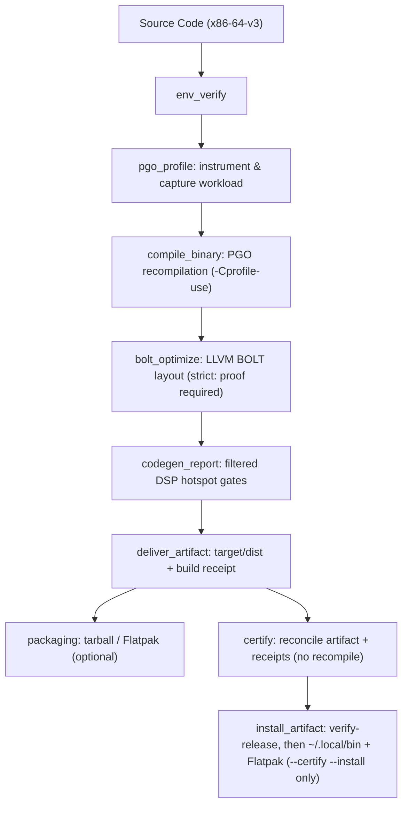

<!--
SPDX-License-Identifier: GPL-3.0-or-later
Copyright (c) 2026 Fábio Henrique de Lima Silva (fhl.bsb@gmail.com) All rights reserved.
-->

# Automated Test Suite & Verification Architecture - `NAM-Audio-Pipe`

This document details the automated testing architecture, verification suites, regression gates, and compiler optimization pipeline for **NAM-Audio-Pipe** ([`../`](../)).

> **Documentation Philosophy**: Source code is the primordial source of truth. This guide does not transcribe implementation details line-by-line; instead, it establishes the testing architecture, explains the *why* behind design invariants, defines critical real-time contracts, and guides developers on running and extending test suites safely.

---

## 1. Scope & Crate Features Taxonomy

`NAM-Audio-Pipe` testing relies on feature flags defined in [`Cargo.toml`](../Cargo.toml):

| Feature Flag       | Purpose                                                               | Operational Scope                                                         |
|:------------------ |:--------------------------------------------------------------------- |:------------------------------------------------------------------------- |
| **`default`**      | Enables `dual-mono` by default (`default = ["dual-mono"]`).           | Production builds and baseline compilation checks.                        |
| **`dual-mono`**    | Propagates `NeuralAmpModeler-rs/dual-mono` for stereo L/R processing. | Default feature enabled across standard builds and audio pipelines.       |
| **`testing`**      | Propagates `NeuralAmpModeler-rs/testing`, `dep:serde`, `dep:sha2`.    | Mandatory for executing unit, integration, and verification tests.        |
| **`heap-audit`**   | Enables counting allocators to verify 0 heap allocations in RT paths. | Used in the long suite's `heap-audit` phase and RT callback safety tests. |
| **`rt-hardening`** | Mirrors `NeuralAmpModeler-rs/rt-hardening` for matrix uniformity.     | Unconditionally active in `[dependencies]`; opt-in feature mirror.        |

### 1.1 Dependency Graph & Binary Targets

- **Engine Feature Graph**: In [`Cargo.toml`](../Cargo.toml), `NeuralAmpModeler-rs` is declared with `version = "2.0.0"`, `default-features = false, features = ["rt-hardening"]`. This ensures the engine's `dual-mono` feature is not unconditionally forced by the dependency line.
- **`--no-default-features` Behavior**: When compiled with `--lib --no-default-features` (as tested by `utils/lints.sh`), `dual-mono` is disabled, allowing the lean single-inference mono pipeline while retaining `rt-hardening`.
- **Target Declarations (`autobins = false`)**: All binary and bench targets are declared explicitly:
  - `nam-audio-pipe` (`src/main.rs`): Production standalone audio host.
  - `io_uring_probe` (`src/bin/io_uring_probe.rs`): Standalone capability probe for Linux `io_uring`.
  - `pgo_workload` (`src/bin/pgo_workload.rs`, `required-features = ["testing"]`): Synthetic training matrix generator for PGO.
  - `pipe_long_receipt` (`src/bin/pipe_long_receipt.rs`, `required-features = ["testing"]`): Receipt generator and validator for `tests-long.sh`.
  - `pipe_perf_gate` (`src/bin/pipe_perf_gate.rs`): CPU topology resolver for pinning RT and benchmark execution.
  - `recording_ab_bench` (`src/bin/recording_ab_bench.rs`, `required-features = ["testing"]`): A/B benchmark for recording transports.
  - `ab_opt_bench` (`src/bin/ab_opt_bench.rs`, `required-features = ["testing"]`): Microarchitectural DSP cycle evaluation harness.
  - `pipe_ab_opt` (`src/bin/pipe_ab_opt.rs`): A/B optimization ceremony verdict evaluator.
  - `rt_gate` (`benches/rt_gate.rs`, `required-features = ["testing"]`): Criterion benchmark for RT regression gates.

---

## 2. Automated Test Inventory

The test architecture separates fast unit tests (verifying isolated module contracts) from integration tests (exercising the full audio graph, disk I/O, IPC, and operating system interfaces).

```text
NAM-Audio-Pipe Test Hierarchy
├── Unit Tests (src/...)
│   ├── CLI & Validation           -> Argument parsing, buffer size & gate domains
│   ├── Real-Time Setup & Hardware -> Thread priority, CPU affinity, PM QoS, activation modes
│   ├── Audio Callback (RT)        -> DSP staging, panic containment, zero-alloc, SPA buffer validation
│   ├── SPSC Resource Swaps        -> Lock-free dynamic model/IR/resampler/oversampling updates
│   ├── Host FSM & Reconnect       -> Stream state transitions, bounded backoff, ControlPlaneWakeup
│   └── Asynchronous Recording     -> Lock-free slot pool, worker lifecycle, disk serialization
└── Integration Tests (tests/...)
    ├── e2e_cli.rs                 -> Black-box subprocess CLI validation & exit codes
    ├── recording.rs               -> Bit-exact WAV persistence, zero-sample streams, io_uring
    ├── recording_fault_injection.rs -> Byte-exact PCM roundtrips, RIFF chunk walker, leak sweeps
    ├── pw_integration.rs          -> Live PipeWire context, stream binding & reconnect
    ├── service_resilience.rs      -> POSIX signal bursts, graceful finalization & fail-closed FSM
    ├── stereo_fidelity.rs         -> Bit-identical L/R channel processing & SNR oracles (> 120 dB)
    ├── activation_fidelity.rs     -> Fast Padé vs Standard activations, resampler lifecycle
    ├── cabsim_partition_latency.rs -> Decoupled CabSim partition latency verification
    ├── oversampling_latency.rs    -> Oversampling filter delay alignment and unit conversion
    ├── pipe_offline_parity.rs     -> Exact parity against f64 and C++ NAMCore reference oracles
    ├── fixtures_freshness.rs      -> Integrity gate for committed model and fixture assets
    ├── swap_stress.rs             -> Multi-producer lock-free swap stress under RT load
    ├── soak_extended.rs           -> Accelerated-timeline soak (320k blocks, RSS stability)
    ├── endurance.rs               -> Real wall-clock endurance (fail-closed validation windows)
    ├── rt_metrics.rs              -> Nanosecond deadline & inter-callback tail jitter profiling
    └── distribution_qa.rs         -> AppStream XML & dist-binary packaging smoke
```

---

### 2.1 Unit Tests (Module-Level)

Each unit test verifies strict architectural invariants directly within the relevant module:

#### CLI & Argument Parsing

- **Location**: [`src/standalone/cli_test.rs`](../src/standalone/cli_test.rs)
- **Contract**: Parses command-line flags, model/IR paths, gain stages (`[-20.0, +20.0]` dB), oversampling factors, and diagnostic modes (`--diagnose`, `--diagnose-full`).
- **Key Invariants**:
  - **Buffer Size Domain**: Strictly `{0} ∪ {2^k | 16 ≤ 2^k ≤ 8192}`. Valid values (`0, 16, 32, ..., 8192`) are accepted; invalid values fail fast with a typed `BufferSizeError` before any PipeWire connection.
  - **Silence Gate Domain**: Polymorphic mode handling:
    - Literals `on`/`true`/`default` map to `GateConfig::default_on()` (open at `-70.0 dBFS`, close at `-80.0 dBFS`).
    - Literals `off`/`false`/`0` map to `GateConfig::Off` (linear threshold `0.0`, permanently open FSM).
    - Numeric thresholds `[-96.0, -20.0]` dBFS derive the close threshold via 10 dB Schmitt hysteresis: `close = max(open − 10 dB, −96 dB)`.
    - Positive finite inputs auto-normalize with a logged warning (`60` → `-60.0 dBFS`).
    - Out-of-domain or malformed inputs reject immediately with exit code 2.

#### Real-Time Thread Setup & PM QoS

- **Location**: [`src/standalone/rt_setup/rt_setup_test.rs`](../src/standalone/rt_setup/rt_setup_test.rs), [`src/standalone/rt_setup/pm_qos.rs`](../src/standalone/rt_setup/pm_qos.rs), [`src/standalone/rt_setup/thread.rs`](../src/standalone/rt_setup/thread.rs)
- **Contract**: Configures thread scheduling, CPU affinity, activation precision mode, and power management constraints.
- **Key Invariants**:
  - Interacts with `/dev/cpu_dma_latency` to pin DMA latency to 0 µs, preventing CPU C-state entry latency spikes during audio streaming.
  - Detects default hardware sinks via `pw-metadata` with a 500 ms watchdog timeout and filters out self-capture loopback nodes.
  - Real-time thread setup explicitly sets thread-local `ActivationPrecision` (`Standard` universal default or `Fast` Padé) on the actual data thread prior to the first DSP quantum, overriding any pre-existing TLS on thread pools or across reconnect cycles.

#### Telemetry & Status Polling

- **Location**: [`src/standalone/rt_setup/telemetry_test.rs`](../src/standalone/rt_setup/telemetry_test.rs)
- **Contract**: Periodically reads atomic bitmasks (`RtStatusFlags`) from the RT thread and publishes throttled off-RT logs.
- **Key Invariants**:
  - **Episode Latches**: Flag and counter signals emit at most once per anomaly episode and re-arm only after the condition clears.
  - **Gate Log Throttling**: Limits gate transition logs to at most one entry per `GATE_LOG_MIN_INTERVAL`, folding rapid chatters into `(×N)` counters.
  - **Diagnostic Format**: Emits concise `[Exxxx | MNEMONIC]` lines without dumping bloated log traces.

#### Shared Memory Bridge

- **Location**: [`src/standalone/pw_host/bridge.rs`](../src/standalone/pw_host/bridge.rs)
- **Contract**: Allocates shared memory for zero-copy lock-free ping-pong transfer between PipeWire capture and playback streams.
- **Key Invariants**: Enforces runtime system page size alignment (supporting 4, 16, and 64 KiB layouts) with full page padding, applies `madvise` memory hints (`MADV_DONTFORK`, `MADV_DONTDUMP`), and verifies atomic generation counter progression.

#### Real-Time Audio Callback & Gain Staging

- **Location**: [`src/standalone/pw_host/rt_callback/process_test.rs`](../src/standalone/pw_host/rt_callback/process_test.rs)
- **Contract**: Executes per-quantum audio processing on the PipeWire real-time thread.
- **Key Invariants**:
  - Zero heap allocation/deallocation on the hot-path (verified under `feature = "heap-audit"`).
  - Handles buffer quantum sizes up to `MAX_BRIDGE_BUF` (8192 frames) without dropping or truncating blocks.
  - Tracks overruns in both blocks and frames (`OVERRUN_COUNT` and `OVERRUN_FRAMES_COUNT`), preserving the reconciliation invariant: `captured_frames == enqueued_frames + lost_frames`.
  - Classifies SPA chunk windows (`Valid`/`Absent`/`Malformed`): corrupt chunks (`SPA_CHUNK_FLAG_CORRUPTED`) or invalid strides raise `RT_STATUS_HOST_CONTRACT_VIOLATION` (E2304) and mute output fail-closed.

#### Real-Time Panic Containment

- **Location**: [`src/standalone/pw_host/rt_callback/mod.rs`](../src/standalone/pw_host/rt_callback/mod.rs)
- **Contract**: Isolates unexpected panics within the RT callback to prevent crashing the host daemon or triggering C-FFI aborts.
- **Key Invariants**:
  - Wraps RT closure bodies in `catch_unwind(AssertUnwindSafe)` once per quantum.
  - On panic, latches the fatal atomic flag `RT_STATUS_PANIC_CAPTURED` (bit 31) and immediately mutes audio.
  - Subsequent callback invocations exit instantly, preventing repetitive panic loops while awaiting graceful teardown.
  - Release profile inherits `panic = "unwind"`, ensuring unwinding containment remains functional in shipped production artifacts.

#### Lock-Free SPSC Resource Swaps & Rebuild Handlers

- **Location**: [`src/standalone/pw_host/rt_callback/commands.rs`](../src/standalone/pw_host/rt_callback/commands.rs), [`cabsim_swap.rs`](../src/standalone/pw_host/rt_callback/cabsim_swap.rs), [`rate_sync.rs`](../src/standalone/pw_host/rt_callback/rate_sync.rs), [`resampler_swap.rs`](../src/standalone/pw_host/rt_callback/resampler_swap.rs), [`slimmable_swap.rs`](../src/standalone/pw_host/rt_callback/slimmable_swap.rs)
- **Contract**: Enables non-blocking, zero-allocation runtime swaps of neural models, cabinet IRs, sample rate converters, and oversampling engines.
- **Key Invariants**:
  - Command rings use bounded SPSC queues. The audio thread drains pending updates without blocking, while old resources cascade to an off-RT garbage collection (GC) queue for safe deallocation.
  - Resampler rebuild generation tracking is strictly idempotent across callbacks while a rebuild is in flight.
  - Slimmable submodel updates swap left and right channels as an atomic pair (`SlimModelPair`), preventing generation or channel count mismatches.

#### Backend State Machine & Fail-Fast SLA

- **Location**: [`src/standalone/pw_host/status_test.rs`](../src/standalone/pw_host/status_test.rs)
- **Contract**: Manages host operational state transitions (`Starting` → `Running` → `Degraded`/`Failed` → `Terminated`).
- **Key Invariants**:
  - **Sticky Failure**: Once marked `Failed`, the state cannot be reverted to `Running` except through a formal reconnection handshake (`begin_reconnect`).
  - **Fail-Fast SLA**: The main control loop observes stream failure and initiates teardown in under 200 ms (assisted by `ControlPlaneWakeup`).

#### Bounded Reconnection Policy

- **Location**: [`src/standalone/pw_host/reconnect_test.rs`](../src/standalone/pw_host/reconnect_test.rs)
- **Contract**: Implements automated reconnection to the PipeWire daemon when interrupted.
- **Key Invariants**:
  - **Default Policy**: 6 attempts with progressive backoff (250 → 500 → 1000 → 2000 → 4000 → 4000 ms), capped at a total budget of 11,750 ms.
  - **Fail-Fast Mode**: `--fail-fast` sets attempts to 0, terminating immediately on stream disconnect.
  - **Stability Reset**: After 60 seconds (`STABLE_RESET`) of uninterrupted healthy streaming, the attempt budget fully replenishes.

#### Asynchronous Recording Engine & Guard Lifecycle

- **Location**: [`src/recording/`](../src/recording/)
- **Contract**: Manages lock-free audio capture to disk without blocking the real-time processing thread.
- **Key Invariants**:
  - **RAII Teardown**: `RecordingWorkerGuard` guarantees bounded worker joins, stopping worker threads and flushing headers safely on drop.
  - **Loss Accounting**: If overruns occurred during recording, the process exits with code 6 (`ExitKind::Recording`), detailing lost frames in `SuccessWithLoss`.
  - **Memory Subsystem Efficiency**: The promoted `RecordingPool` slot transport reduces memory subsystem traffic by ~57% compared to traditional inline SPSC rings.

#### PipeWire Log Redirection & Off-RT Log Ring

- **Location**: [`src/standalone/pw_host/log_redirect.rs`](../src/standalone/pw_host/log_redirect.rs), [`rt_log_ring.rs`](../src/standalone/pw_host/rt_log_ring.rs)
- **Contract**: Intercepts C-ABI PipeWire logs and routes them safely away from the real-time audio thread.
- **Key Invariants**:
  - Uses a fixed 1024-byte stack buffer with allocation-free UTF-8 conversion via pure-Rust Rust 1.99 variadics.
  - Audio threads marked via TLS (`rt_log_mark`) divert log messages into a pre-allocated SPSC ring (~344 KiB), avoiding blocking `log::*` macros on the audio thread.

---

### 2.2 Integration Test Suites ([`tests/`](../tests/))

Integration tests validate full-system behavior against real external interfaces, subprocesses, and filesystems:

| Integration Test File                                                         | Primary Architectural Focus                                                                                 | Execution Tier / Phase                     |
|:----------------------------------------------------------------------------- |:----------------------------------------------------------------------------------------------------------- |:------------------------------------------ |
| [`tests/e2e_cli.rs`](../tests/e2e_cli.rs)                                     | Subprocess black-box CLI smoke tests, argument domains, and typed exit codes.                               | Fast Dev / `phase0`                        |
| [`tests/recording.rs`](../tests/recording.rs)                                 | Asynchronous disk writer loop, zero-sample streams, byte-size equality, and `pw-play` live testing.         | `#[ignore]` / `phase9`                     |
| [`tests/recording_fault_injection.rs`](../tests/recording_fault_injection.rs) | RIFF chunk walker, bit-exact PCM roundtrips, disk exhaustion resilience, and descriptor leak sweeps.        | `#[ignore]` / `phase9`                     |
| [`tests/pw_integration.rs`](../tests/pw_integration.rs)                       | Live PipeWire context creation, dual-stream graph binding, tone driver, and daemon restart resilience.      | `#[ignore]` / `phase7`, `phase8`           |
| [`tests/service_resilience.rs`](../tests/service_resilience.rs)               | Real `SIGTERM` signals, 500 ms burst grace windows, starvation silence, and fail-closed format violations.  | `phase0`, `phase8`                         |
| [`tests/stereo_fidelity.rs`](../tests/stereo_fidelity.rs)                     | Independent dual-channel L/R DSP processing and bit-exact parity against mono baseline (SNR > 120 dB).      | Fast Dev / `phase0`                        |
| [`tests/activation_fidelity.rs`](../tests/activation_fidelity.rs)             | TLS propagation of `ActivationPrecision` (`Fast` Padé vs `Standard`), and resampler lifecycle fidelity.     | Fast Dev / `phase0`                        |
| [`tests/cabsim_partition_latency.rs`](../tests/cabsim_partition_latency.rs)   | Proves CabSim partition latency is strictly shaped independent of host quantum bounds.                      | Fast Dev / `phase0`                        |
| [`tests/oversampling_latency.rs`](../tests/oversampling_latency.rs)           | End-to-end DSP latency accounting across oversampling ratios with impulse peak alignment.                   | Fast Dev / `phase0`                        |
| [`tests/pipe_offline_parity.rs`](../tests/pipe_offline_parity.rs)             | Full numerical verification against f64 analytical oracle and C++ NAMCore oracle (`NAM_CORE_RENDER_BIN`).   | `#[ignore]` / `phase10`                    |
| [`tests/calibration_modes_test.rs`](../tests/calibration_modes_test.rs)       | Input calibration / output modes parity, startup metadata policy, pre-nonlinearity saturation & gate isolation. | Fast Dev / `phase0`                        |
| [`tests/musical_gate_parity_test.rs`](../tests/musical_gate_parity_test.rs) | Musical noise gate C++ `f64` oracle parity (`44.1/48/96 kHz`), pre-cal/pre-IR ordering, stereo isolation, continuous recording & RT `heap-audit`. | Fast Dev / `phase0`                        |
| [`tests/cabinet_slot_and_bypass_test.rs`](../tests/cabinet_slot_and_bypass_test.rs) | Single exclusive cabinet slot (`.wav`/`.nam`/`.namb`), fail-closed guards, `Linear`/`Sequential` `f64` oracle parity, `--cab-bypass` constant latency/crossfade across `44.1/48/96 kHz`, `testing,heap-audit` & `--no-default-features`. | Fast Dev / `phase0` |
| [`tests/fixtures_freshness.rs`](../tests/fixtures_freshness.rs)               | Cryptographic SHA-256 validation of committed test model fixtures against `.manifest.sha256`.               | Fast Dev / `phase0`                        |
| [`tests/swap_stress.rs`](../tests/swap_stress.rs)                             | Multi-producer concurrent swap flood (models, IRs, resamplers, gains) under live audio processing.          | `phase1`, `phase2`                         |
| [`tests/soak_extended.rs`](../tests/soak_extended.rs)                         | Accelerated timeline soak (320,000 blocks), zero minor/major page faults, and stable RSS (< 256 KiB drift). | `#[ignore]` / `phase1`                     |
| [`tests/endurance.rs`](../tests/endurance.rs)                                 | Real wall-clock endurance testing at 48 kHz / 64 frames (`NAM_ENDURANCE_SECONDS`, default 30 s).            | `#[ignore]` / `phase6`                     |
| [`tests/rt_metrics.rs`](../tests/rt_metrics.rs)                               | Nanosecond monotonic clock profiling: deadline gate (< 85% quantum budget), tail jitter, and concurrency.   | `#[ignore]` / `phase3`, `phase4`, `phase5` |
| [`tests/distribution_qa.rs`](../tests/distribution_qa.rs)                     | Strict AppStream XML validation (`io.github.fabiohl.NAMAudioPipe.metainfo.xml`) and binary smoke checks.    | Fast Dev / `phase0`                        |

---

## 3. Verification Scripts & QA Suite (`utils/`)

Executable verification scripts in [`utils/`](../utils/) automate testing across different developer and CI phases:

### 3.1 Static Quality Gate ([`utils/lints.sh`](../utils/lints.sh))

Class A script. Budget: 100 lines. It runs the following steps in order and aborts on the first failure:

1. **Formatting (`fmt`):** `cargo fmt --all` is applied during local development; with `CI=true` it verifies via `-- --check`.
2. **Compilation matrix (`check`):** `cargo check --locked` for all-targets/all-features, lib/no-default-features, and all-targets/no-default-features.
3. **Strict Clippy (`clippy`):** The same compilation matrix with `-- -D warnings`.
4. **Documentation (`doc`):** `RUSTDOCFLAGS="-D warnings" cargo doc --locked --no-deps --all-features` must build with zero warnings.
5. **SPDX headers (`spdx`):** Every tracked `.rs`, `.sh`, `.py`, `build.rs`, and `Cargo.toml` must carry `GPL-3.0-or-later` or `MIT`.
6. **Text policies (`policies`):** Verifies documented `#[allow(clippy::...)]` suppressions and enforces centralized `log::set_max_level`.
7. **Packaging (`packaging`):** Mandatory Flatpak/AppStream/desktop paths, plus `appstreamcli validate --no-net --strict` and `desktop-file-validate`.
8. **Script budget (`script-budget`):** Verifies that every `utils/*.sh` script declares `# Orçamento: <n>` and stays within its budget.

### 3.2 Quick Discipline ([`utils/tests-quick.sh`](../utils/tests-quick.sh))

Class A script with two invocations in the development profile: `cargo test --locked --features testing --no-fail-fast` (default `dual-mono`) and `cargo test --locked --no-default-features --features testing --no-fail-fast` (lean single-inference mono path). `#[ignore]` tests are skipped by construction; harnesses that assert per-channel `dual-mono` semantics are `#[cfg(feature = "dual-mono")]` and therefore absent from the lean run instead of producing false failures. Emits `scope=quick`, never builds release, never emits receipts, and must complete within 5 minutes with a warm cache.

### 3.3 Long Audit Suite ([`utils/tests-long.sh`](../utils/tests-long.sh))

Class B script, operator-only. It records every phase result instead of aborting on the first failure, runs all `#[ignore]` product suites in release mode, and, with `--artifact`, binds the machine-readable receipt to the exact SHA-256 of `target/dist/nam-audio-pipe`.

> [!CAUTION]
> **Human Operator Exclusive:** AI agents may inspect `--help` but must never execute this suite.

`--strict` promotes any `GAP` to `FAIL` and exports `NAM_RT_STRICT=1`; `NAM_PHASE_TIMEOUT_S` overrides the per-phase timeout. The 11 canonical phases are:

| Receipt `phase_id` | Canonical Phase  | Harness & Invariant Evaluated                                                                                                                                                                                                               | Default Timeout | Output Log File                       |
|:------------------ |:---------------- |:------------------------------------------------------------------------------------------------------------------------------------------------------------------------------------------------------------------------------------------- |:---------------:|:------------------------------------- |
| **`phase0`**       | `catch-all`      | `cargo test --locked --features testing --release --no-fail-fast` (non-ignored: `e2e_cli`, `distribution_qa`, `stereo_fidelity`, `activation_fidelity`, `fixtures_freshness`, `oversampling_latency`, `cabsim_partition_latency`, `--lib`). | 900 s           | `target/logs/long-catch-all.log`      |
| **`phase1`**       | `soak`           | `tests/soak_extended.rs` (320k blocks, compressed timeline) + `tests/swap_stress.rs`; asserts stable RSS.                                                                                                                                   | 1800 s          | `target/logs/long-soak.log`           |
| **`phase2`**       | `heap-audit`     | `cargo test --locked --features "testing heap-audit" --release` over `--lib` and `tests/swap_stress.rs`; asserts zero heap allocations on RT paths.                                                                                         | 1800 s          | `target/logs/long-heap-audit.log`     |
| **`phase3`**       | `rt-deadline`    | `tests/rt_metrics.rs` (`deadline`, 10k quantums, DSP load < 85% of quantum budget; `SCHED_FIFO` when available).                                                                                                                            | 900 s           | `target/logs/long-rt-deadline.log`    |
| **`phase4`**       | `rt-jitter`      | `tests/rt_metrics.rs` (`jitter`, 10k callbacks under contention; tail jitter $p99.99 \le 0.75 \cdot T$ on isolated CPU).                                                                                                                    | 900 s           | `target/logs/long-rt-jitter.log`      |
| **`phase5`**       | `concurrency`    | `tests/rt_metrics.rs` (`concurrent`; 16 threads racing swap requests, stream transitions, and SPSC rings without deadlocks).                                                                                                                | 900 s           | `target/logs/long-concurrency.log`    |
| **`phase6`**       | `endurance`      | `tests/endurance.rs` (real timeline at 48 kHz/64 frames, `NAM_ENDURANCE_SECONDS`; fail-closed validation windows and zero leaks).                                                                                                           | 1800 s          | `target/logs/long-endurance.log`      |
| **`phase7`**       | `pw-resilience`  | `tests/pw_integration.rs` against a private daemon; asserts reconnection and exhaustion handling.                                                                                                                                           | 900 s           | `target/logs/long-pw-resilience.log`  |
| **`phase8`**       | `pw-live`        | Live daemon + `pw-play` + `io_uring` capability probe, then `tests/pw_integration.rs` and `tests/service_resilience.rs` (`SIGTERM`/double-signal acceptances).                                                                              | 900 s           | `target/logs/long-pw-live.log`        |
| **`phase9`**       | `recording`      | `io_uring_probe` and live PipeWire capability gates, then `tests/recording.rs` and `tests/recording_fault_injection.rs` (`--ignored`).                                                                                                      | 1200 s          | `target/logs/long-recording.log`      |
| **`phase10`**      | `offline-parity` | `tests/pipe_offline_parity.rs` plus `--diagnose` on the canonical artifact when `--artifact` is used. Compares against f64 oracle and NAMCore C++ oracle (`NAM_CORE_RENDER_BIN`).                                                           | 900 s           | `target/logs/long-offline-parity.log` |

Every phase writes `target/logs/long-<name>.log`. The human-readable text receipt is `target/logs/long-receipt.txt` and the typed JSONL receipt is `target/logs/long-audit-receipt.jsonl`.

`--only <name>[,<name>]` accepts only canonical phase names. It sets `SCOPE=partial` and emits `MODE: partial`, preserving `target/long` and writing `target/logs/long-audit-receipt.partial.jsonl` (with `long-receipt.partial.txt` and the sibling partial fail-reasons file). Non-selected phases are recorded as `SKIPPED`. A partial receipt is audited cleanly but strictly rejected by `pipe_long_receipt certify`. Without `--only`, the receipt can be validated via `pipe_long_receipt validate [--strict]` and certified for release.

#### 3.3.1 Hosted CI and Manual Long Workflow (GitHub Actions)

- **`ci.yml`:** Static analysis and fast test disciplines execute across isolated matrix jobs:
  - `x86_64-linux-lints`: Runs `utils/lints.sh` with strict Clippy, AppStream, and doc gates (blocking).
  - `x86_64-linux-quick`: Runs `utils/tests-quick.sh` across both `dual-mono` and lean mono profiles (blocking).
  - `linux-arm64-lints`: Validates compilation and lints on ARM64 architecture (blocking gate).
  - `linux-arm64-quick`: Runs quick tests on ARM64 (`continue-on-error` advisory; bare-metal hardware and RT-deadline certification remain unperformed on ARM).
  - `msrv`: Enforces minimum supported Rust version (`1.99.0`) using `--locked --all-targets --all-features`.
  - **Deterministic Provenance**: Each job sources [`variables.env`](../variables.env) (`ENGINE_COMMIT`), writes `target/logs/ci-provenance.log`, and uploads `target/logs/**` (including `*-status.tsv` carriers).
- **`long.yml`:** Operator-triggered manual workflow (`workflow_dispatch`, zero inputs, `timeout-minutes: 300`). Provisions BOLT, perf counters, the C++ parity oracle (`NAM_CORE_RENDER_BIN`), a private D-Bus session, and persistent PipeWire sink/source nodes (`ci-null-sink`, `ci-null-source`). Executes hosted-safe phases (`catch-all`, `soak`, `heap-audit`, `concurrency`, `endurance`, `pw-resilience`, `pw-live`, `recording`, `offline-parity`), leaving isolated hardware phases (`rt-deadline`, `rt-jitter`) for bare-metal operator execution.

---

## 4. Build & Release Chain ([`utils/build-release.sh`](../utils/build-release.sh))

`NAM-Audio-Pipe` employs a multi-stage Profile-Guided Optimization (PGO) and LLVM BOLT pipeline to maximize cache locality and execution speed. The build discipline **only builds**: it never runs test suites, and deposits the canonical artifact at `target/dist/nam-audio-pipe` alongside `target/dist/build-receipt.json`.



### 4.1 Release Execution Workflow

The operator (or external release automation) runs exactly three sequential commands:

1. `./utils/build-release.sh --strict [--package]` — builds the optimized binary and emits `build-receipt.json`. Under `--strict`, an A/B optimization ceremony proof (`target/logs/ab-opt-ceremony-receipt.json`) is evaluated if present (opt-in preflight). If present, `PGO+BOLT`, `PGO-ONLY`, and `UNOPTIMIZED` (plain fallback) verdicts are accepted.
2. `./utils/tests-long.sh --strict --artifact` — audits the canonical artifact and binds every receipt line to its SHA-256.
3. `./utils/build-release.sh --strict --certify --install` — hashes the artifact again, reconciles build and long receipts, and writes `target/dist/release-receipt.json`. If certified, installs the binary atomically to `~/.local/bin/nam-audio-pipe` and updates the Flatpak user bundle.

### 4.2 A/B Optimization Ceremony & Promotion Policy

The A/B optimization ceremony (`utils/ab-opt-ceremony.sh` and `pipe_ab_opt compare`) evaluates DSP cycles across all canonical topologies (`wavenet_a1`, `wavenet_a2`, `lstm`) over at least 3 measured runs. The promotion rule operates on median `p99` cycles per topology with an explicit 1.0% margin (`PROMOTION_MARGIN_PCT = 1.0%`):

- **`PGO-ONLY`**: Satisfied when, for **all** topologies $t$:
  $$\text{median}(p99_{\text{pgo}}[t]) \le \text{median}(p99_{\text{plain}}[t]) \times (1 - 0.010)$$
- **`PGO+BOLT`**: Satisfied when `PGO-ONLY` holds **and**, for **all** topologies $t$:
  $$\text{median}(p99_{\text{bolt}}[t]) \le \text{median}(p99_{\text{pgo}}[t]) \times (1 - 0.010)$$
- **`UNOPTIMIZED`**: Returned when PGO fails to beat the plain baseline by at least 1.0% on any topology (`verdict_reason=pgo_margin_not_met`), or when the plain baseline is proven faster or lower jitter.

#### Hardware Microarchitecture & Branch Tracing (LBR)

LLVM BOLT requires hardware branch sampling via Intel Last Branch Records (LBR, `perf record -j any,u` or `-b`).

- **Intel Hardware**: LBR captures exact basic-block branch transitions, enabling accurate profile-guided basic block layout.
- **AMD Hardware (Zen 1–4) & Virtualization**: Hardware LBR is unavailable (`perf record -j any,u` fails with `not supported`). In fallback sampling mode (`cycles:u`), perf cannot trace branch history, causing LLVM BOLT to operate with 100% control-flow graph (CFG) discontinuity.
- **Empirical Degradation**: On AMD Zen 2 (Ryzen 7 5700U), non-LBR BOLT was measured to produce a -1.65% mean latency regression, -2.10% p99 regression, +26.1% max cycle spike in WaveNet A1, +152.5% max cycle spike in LSTM, and +61% instruction-cache misses.
- **Automated Guard**: `ab-opt-ceremony.sh` actively probes for LBR support (`perf record -j any,u -o /dev/null -- true`). When LBR is absent (`LBR=0`), BOLT optimization is automatically bypassed, emitting gap `bolt_lbr_unsupported`.

#### Promotion Fallback Invariants

1. `build-release.sh` detects `PGO+BOLT`, `PGO-ONLY`, or `UNOPTIMIZED` automatically via `pipe_long_receipt ceremony-proof`.
2. **`PGO-ONLY` Fallback**: When BOLT does not beat PGO by $\ge 1.0\%$ across all topologies (`verdict_reason=bolt_margin_not_met`) or LBR is absent: `build-release.sh` emits `PHASE: bolt_optimize PASS`, sets `bolt_status=not_proven` and `bolt_proof=fallback_pgo_only` in the build receipt. Profile-use compilation proceeds with the PGO-optimized binary.
3. **`PLAIN-ONLY` Fallback (`UNOPTIMIZED`)**: When PGO does not beat the plain baseline by $\ge 1.0\%$ across all topologies (`verdict_reason=pgo_margin_not_met`), the plain compiler release binary (`RUSTFLAGS="-C target-cpu=x86-64-v3"`) is proven to have lower latency and lower jitter (e.g. dense SIMD/AVX2 WaveNet loops without complex branching). `build-release.sh` skips PGO instrumentation/use cycles and skips BOLT, compiling directly in plain release mode. It records `bolt_status=skipped_unoptimized` and `bolt_proof=fallback_plain`.
4. Under `--strict`, `build-release.sh` completes with `PASS` and delivers the certified binary without failure for all valid optimization verdicts (`PGO+BOLT`, `PGO-ONLY`, and `fallback_plain`).
5. In `--certify`, `evaluate_certification` accepts proven `PGO-ONLY` (recording `verdict="PGO-ONLY"`) and proven plain fallback (recording `verdict="PLAIN-ONLY"`, `status="CERTIFIED"`), verifying that the release binary matches the proven optimal configuration.

### 4.3 PGO Workload Coverage Matrix

During Phase 2, `src/bin/pgo_workload.rs` executes a comprehensive training matrix across all DSP kernels:

| Matrix Dimension     | Evaluated Values                   | Weight Distribution                  |
|:-------------------- |:---------------------------------- |:------------------------------------ |
| **Sample Rates**     | 44.1 kHz, 48.0 kHz, 96.0 kHz       | 25% / 50% / 25%                      |
| **Quantum Sizes**    | 32, 64, 128, 256, 512, 1024 frames | 10% / **40%** / 15% / 20% / 10% / 5% |
| **Model Topologies** | WaveNet A1, WaveNet A2, LSTM       | Equal (33.3% each)                   |
| **Oversampling**     | Off, 2×, 4×                        | 60% / 20% / 20%                      |
| **Cabinet IR**       | Enabled (Convolution), Bypass      | 70% / 30%                            |
| **Noise Gate**       | Enabled, Disabled                  | 50% / 50%                            |
| **Recording Pool**   | Enabled, Disabled                  | 50% / 50%                            |

The workload generates `target/logs/pgo-workload-receipt.json`, verifying that every model topology processes at least 1,000 blocks and no DSP stage is skipped.

### 4.4 Static Assembly & Microarchitectural Gates

After BOLT layout optimization, `utils/dsp-hotpath-filter.py` analyzes the disassembled hot-path (`target/logs/codegen/dsp_hotpath.asm`, mirrored to `target/dsp_hotpath.asm`), enforcing strict static architectural rules with target-by-target coverage ([`utils/codegen-profile.json`](../utils/codegen-profile.json)):

- **Target Coverage**: Tracks mandatory presence for `capture_dsp_pipeline`, `playback_dsp_cycle`, `process_dsp_buffer`, `process_block_internal`, `tanh_and_accumulate`, `cabsim_adapter`, `conv_engine`, and `resampler`.
- **Fail-Closed Disassembly**: Rejects empty or partial disassembly before running filter gates; non-zero exits abort the build immediately.
- **Zero AVX-512 Vectors on x86-64-v3 Baseline**: Prohibits `zmm` registers, EVEX vector extensions (`xmm16-31`, `ymm16-31`), and opmasks (`%k0-%k7`) in baseline artifacts.
- **Zero `libm` and Allocations in RT Hotpaths**: Strictly forbids runtime heap allocation symbols (`alloc`, `__rust_alloc`) and scalar math library calls in DSP loops.

---

## 5. Developer Workflow & Execution Guide

All test commands must be executed from the root of the `./NAM-Audio-Pipe/` repository:

### 5.1 Utility Scripts Reference

| Script                       | Primary Responsibility                                                                                         | Target Audience / Frequency      |
|:---------------------------- |:-------------------------------------------------------------------------------------------------------------- |:-------------------------------- |
| **`utils/lints.sh`**         | Class A: formatting applied (verified in CI), check/clippy matrix, doc, SPDX, packaging.                       | Continuous / Every commit        |
| **`utils/tests-quick.sh`**   | Class A: dev-profile `cargo test` across `dual-mono` and lean mono, skipping `#[ignore]`.                      | Pre-merge / Fast testing         |
| **`utils/tests-long.sh`**    | Class B: 11-phase comprehensive audit (catch-all, soak, zero-alloc, RT, endurance, live PipeWire, f64 parity). | Operator / Release qualification |
| **`utils/build-release.sh`** | Class C: multi-stage PGO/BOLT compilation, packaging, artifact delivery, and certification.                    | Production releases              |
| **`utils/miri-audit.sh`**    | Class D: out-of-band formal aliasing and data-race audit for lock-free memory structures.                      | Maintenance / Unsafe code audit  |

### 5.2 Direct Command Cheat Sheet

```bash
# -----------------------------------------------------------------------------
# 1. Static Quality Gate
# -----------------------------------------------------------------------------
./utils/lints.sh

# -----------------------------------------------------------------------------
# 2. Quick Discipline (development profile, non-ignored targets)
# -----------------------------------------------------------------------------
./utils/tests-quick.sh

# -----------------------------------------------------------------------------
# 3. Unit tests only
# -----------------------------------------------------------------------------
cargo test --features testing --lib

# -----------------------------------------------------------------------------
# 4. CLI end-to-end black-box tests
# -----------------------------------------------------------------------------
cargo test --features testing --test e2e_cli

# -----------------------------------------------------------------------------
# 5. Live PipeWire integration (requires a running daemon)
# -----------------------------------------------------------------------------
cargo test --features testing --release --test pw_integration -- --ignored --nocapture

# -----------------------------------------------------------------------------
# 6. Asynchronous recording integration (io_uring)
# -----------------------------------------------------------------------------
cargo test --features testing --release --test recording -- --ignored --nocapture

# -----------------------------------------------------------------------------
# 7. Distribution QA & packaging audit
# -----------------------------------------------------------------------------
cargo test --features testing --test distribution_qa

# -----------------------------------------------------------------------------
# 8. Release chain (human operator only): build -> long audit -> certify
# -----------------------------------------------------------------------------
./utils/build-release.sh --strict --package
./utils/tests-long.sh --strict --artifact
./utils/build-release.sh --strict --certify --install
```

---

## 6. Architectural Contracts & Quality Gates

The following contractual rules are enforced across test suites and CI checks:

| Quality Gate                | Target Contract / Boundary Threshold                                                                                                     | Enforcement Location                                         |
|:--------------------------- |:---------------------------------------------------------------------------------------------------------------------------------------- |:------------------------------------------------------------ |
| **Real-Time Memory Safety** | Exactly 0 heap allocations / deallocations in the RT callback.                                                                           | Verified under `feature = "heap-audit"`                      |
| **Lock-Free Concurrency**   | Zero mutex locks or blocking system calls on the audio thread.                                                                           | Architecture review & static analysis                        |
| **WAV Header Integrity**    | Finalized WAV `data` chunk header size must match the exact PCM payload bytes written to disk.                                           | `tests/recording.rs`, `tests/recording_fault_injection.rs`   |
| **Buffer Size Domain**      | Strictly `{0} ∪ {2^k \| 16 ≤ 2^k ≤ 8192}`. Out-of-domain inputs reject fail-fast with typed `BufferSizeError`.                           | `src/standalone/cli.rs`, `tests/e2e_cli.rs`                  |
| **Silence Gate Domain**     | Polymorphic mode: `on`/`off` or `[-96.0, -20.0]` dBFS threshold with 10 dB Schmitt hysteresis. Rejected fail-fast on malformed inputs.   | `src/standalone/cli.rs`, `tests/e2e_cli.rs`                  |
| **RT Quantum Bounds**       | Maximum supported quantum is `MAX_BRIDGE_BUF` (8192 frames / 32,768 bytes). Larger descriptors reject fail-closed.                       | `src/standalone/pw_host/rt_callback/process.rs`              |
| **RT Deadline Processing**  | Worst-case processing per quantum must be < 85% of quantum budget `(N/SR)` over 10,000 quantums.                                         | `tests/rt_metrics.rs`, `utils/tests-long.sh` (`rt-deadline`) |
| **Target CPU Baseline**     | Strictly `x86-64-v3` (AVX2, FMA, BMI2). No scalar runtime fallbacks.                                                                     | `.cargo/config.toml`                                         |
| **AppStream XML Validity**  | Metainfo parses under strict XML; exactly one `<release>` tag matching `CARGO_PKG_VERSION` with a valid `date`.                          | `tests/distribution_qa.rs`, `utils/lints.sh`                 |
| **Release Provenance**      | `target/dist/build-receipt.json` records artifact SHA-256, git provenance, locked engine provenance, and PGO/BOLT optimization evidence; reconciled fail-closed via `pipe_long_receipt build-status`. | `src/receipt/build.rs`, `utils/build-release.sh`             |
| **Metrology Tail Precision**| E2E latency gate enforces conservative histogram upper bounds (`p99_source=histogram`), while exact reservoir samples are labeled for coverage (`p99_exact_coverage=full\|partial`). | `tests/pw_integration.rs`                                    |

---

## 7. Script Contract & Automation Disciplines

All automation scripts in `utils/` follow a lean, predictable contract designed for deterministic automation and reproducible CI.

### 7.1 Script Classes & Error Handling

| Class                         | Scripts                          | Error Handling                                                                                      | Rationale                                                             |
|:----------------------------- |:-------------------------------- |:--------------------------------------------------------------------------------------------------- |:--------------------------------------------------------------------- |
| **Class A — Interactive**     | `lints.sh`, `tests-quick.sh`     | `set -euo pipefail`; aborts on first failure; `ERR` trap emits `RESULT: FAIL`.                      | Real-time developer loops; immediate failure conserves cycles.        |
| **Class B — Decoupled Audit** | `tests-long.sh`                  | `set -o pipefail` (no `-e`, no `-u`); every phase records its status; exit `1` if any phase failed. | Pre-release audits collect all phase evidence without aborting early. |
| **Class C — Build**           | `build-release.sh`               | `set -euo pipefail`; aborts on first failure.                                                       | An intermediate build failure invalidates all downstream artifacts.   |
| **Class D — Manual Tool**     | `miri-audit.sh`, `mod-update.sh` | `set -euo pipefail`.                                                                                | Operator-supervised, opt-in tools.                                    |

### 7.2 Output Protocol & Carrier Lifecycle (`utils/_lib.sh`)

1. **Phase Announcement**: `PHASE: <phase_name>`
2. **Phase Completion**: `PHASE: <phase_name> PASS|FAIL|GAP ... log=<path>`
3. **Unified Final Line**: `RESULT: PASS|PASS_WITH_GAPS|FAIL (<seconds>s) fails=<list|none> gaps=<list|none> scope=<full|partial>`
4. **Exit Codes**: `0` for success or `PASS_WITH_GAPS` outside strict mode; `1` for failure or gaps under `--strict`; `2` for usage errors.
5. **Typed Status Carrier**: Each `finish` writes `target/logs/<script>-status.tsv`: one line, five TAB-separated columns:
   $$\text{<discipline>}\quad\text{<STATUS>}\quad\text{<gaps>}\quad\text{<fails>}\quad\text{<scope>}$$

### 7.3 Canonical Environment Variables

| Variable                 | Configured By                 | Read By                        | Purpose & Semantics                                                         |
|:------------------------ |:----------------------------- |:------------------------------ |:--------------------------------------------------------------------------- |
| `CI`                     | CI Runner                     | `utils/lints.sh`               | When `true`, verifies formatting via `--check` instead of applying changes. |
| `NAM_RUN_ID`             | `utils/_lib.sh` / CI          | All scripts & harnesses        | Unique execution run identifier for isolating logs and receipts.            |
| `NAM_RT_STRICT`          | `tests-long.sh --strict`      | `tests/rt_metrics.rs`          | Promotes real-time GAP conditions to hard test failures.                    |
| `NAM_REQUIRE_CPP_ORACLE` | `tests-long.sh --strict` / CI | `tests/pipe_offline_parity.rs` | Requires C++ NAMCore oracle presence; halts fail-closed if missing.         |
| `NAM_CORE_RENDER_BIN`    | Shell / CI Runner             | `tests/pipe_offline_parity.rs` | Absolute path to the compiled C++ reference render binary.                  |
| `NAM_PHASE_TIMEOUT_S`    | Operator                      | `utils/tests-long.sh`          | Overrides the per-phase timeout duration for long-audit test commands.      |
| `NAM_ENDURANCE_SECONDS`  | Operator                      | `tests/endurance.rs`           | Wall-clock execution duration for the real-time endurance suite.            |
| `NAM_THERMAL_COOLDOWN_S` | Operator                      | `utils/ab-opt-ceremony.sh`     | Cooling sleep in seconds between benchmark runs.                            |
| `NAM_BENCH_CORE`         | Operator                      | `src/bin/pipe_perf_gate.rs`    | Explicit CPU core affinity for running benchmarks.                          |

---

## 8. References

- [NAM-Audio-Pipe Architecture](architecture.md) — Comprehensive threading model, host lifecycle, and memory layout.
- [`NeuralAmpModeler-rs`](https://github.com/fabiohl/NeuralAmpModeler-rs) — Agnostic neural DSP engine.
- [PipeWire Official Documentation](https://docs.pipewire.org/) — Linux audio graph daemon and SPA API reference.
