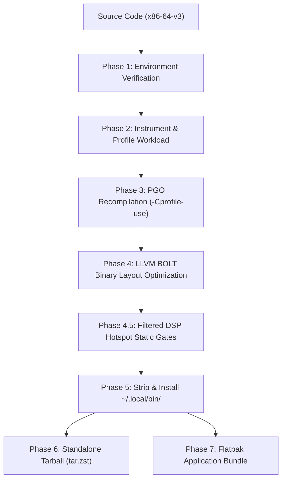

<!--
SPDX-License-Identifier: GPL-3.0-or-later
Copyright (c) 2026 Fábio Henrique de Lima Silva (fhl.bsb@gmail.com) All rights reserved.
-->

# Automated Test Suite & Verification Architecture - `NAM-Audio-Pipe`

This document details the automated testing architecture, verification suites, regression gates, and compiler optimization pipeline for **NAM-Audio-Pipe** ([`../`](../)).

> **Documentation Philosophy**: Source code is the primordial source of truth. This guide does not transcribe implementation details line-by-line; instead, it establishes the testing architecture, explains the *why* behind design invariants, defines critical real-time contracts, and guides developers on running and extending test suites safely.

---

## 1. Scope & Crate Features Taxonomy

`NAM-Audio-Pipe` testing relies on feature flags defined in [`Cargo.toml`](../Cargo.toml):

| Feature Flag     | Purpose                                                                | Operational Scope                                                  |
|:---------------- |:---------------------------------------------------------------------- |:------------------------------------------------------------------ |
| **`default`**    | Empty feature set for standalone production binaries.                  | Production builds and baseline compilation checks.                 |
| **`testing`**    | Propagates `NeuralAmpModeler-rs/testing`, exposing mocks and fixtures. | Mandatory for executing unit, integration, and verification tests. |
| **`heap-audit`** | Enables counting allocators to verify 0 heap allocations in RT paths.  | Used in Phase 2 of the long audit and RT callback safety tests.    |

---

## 2. Automated Test Inventory

The test architecture separates fast unit tests (verifying isolated module contracts) from integration tests (exercising the full audio graph, disk I/O, IPC, and operating system interfaces).

```text
NAM-Audio-Pipe Test Hierarchy
├── Unit Tests (src/...)
│   ├── CLI & Validation           -> Argument parsing, buffer size & gate domains
│   ├── Real-Time Setup & Hardware -> Thread priority, CPU affinity, PM QoS
│   ├── Audio Callback (RT)        -> DSP staging, panic containment, zero-alloc
│   ├── SPSC Resource Swaps        -> Lock-free dynamic model/IR/resampler updates
│   ├── Host FSM & Reconnect       -> Stream state transitions, bounded exponential backoff
│   └── Asynchronous Recording     -> Lock-free slot pool, worker lifecycle, disk serialization
└── Integration Tests (tests/...)
    ├── e2e_cli.rs                 -> Black-box subprocess CLI validation & exit codes
    ├── recording*.rs              -> Bit-exact WAV persistence, fault-injection & io_uring
    ├── pw_integration.rs          -> Live PipeWire context, stream binding & reconnect
    ├── service_resilience.rs      -> POSIX signal bursts, graceful finalization & fail-closed FSM
    ├── stereo_fidelity.rs         -> Bit-identical L/R channel processing & SNR oracles
    ├── swap_stress.rs             -> Multi-producer lock-free swap stress under RT load
    ├── soak_extended.rs           -> Accelerated-timeline soak (320k blocks, RSS stability)
    ├── endurance.rs               -> Real wall-clock endurance (fail-closed validation windows)
    ├── rt_metrics.rs              -> Nanosecond deadline & inter-callback jitter profiling
    └── distribution_qa.rs         -> AppStream XML, release provenance & receipt audits
```

---

### 2.1 Unit Tests (Module-Level)

Each unit test verifies strict architectural invariants directly within the relevant module:

#### CLI & Argument Parsing

- **Location**: [`src/standalone/cli_test.rs`](../src/standalone/cli_test.rs)
- **Contract**: Parses command-line flags, model/IR paths, gain stages (`[-20.0, +20.0]` dB), oversampling factors, and diagnostic modes (`--diagnose`, `--diagnose-full`).
- **Key Invariants**:
  - **Buffer Size Domain**: Strictly `{0} ∪ {2^k | 16 ≤ 2^k ≤ 8192}`. Valid values (`0, 16, 32, ..., 8192`) are accepted; invalid values (non-powers-of-two, below 16, above 8192) fail fast with a typed `BufferSizeError` before any PipeWire connection.
  - **Silence Gate Domain**: Polymorphic mode handling:
    - Literals `on`/`true`/`default` map to `GateConfig::default_on()` (open at `-70.0 dBFS`, close at `-80.0 dBFS`).
    - Literals `off`/`false`/`0` map to `GateConfig::Off` (linear threshold `0.0`, permanently open FSM).
    - Numeric thresholds `[-96.0, -20.0]` dBFS (with optional `db`/`dbfs` suffix) derive the close threshold via 10 dB Schmitt hysteresis: `close = max(open − 10 dB, −96 dB)`.
    - Positive finite inputs auto-normalize with a logged warning (`60` → `-60.0 dBFS`).
    - Out-of-domain or malformed inputs reject immediately with exit code 2.

#### Real-Time Thread Setup & PM QoS

- **Location**: [`src/standalone/rt_setup/rt_setup_test.rs`](../src/standalone/rt_setup/rt_setup_test.rs), [`src/standalone/rt_setup/pm_qos.rs`](../src/standalone/rt_setup/pm_qos.rs)
- **Contract**: Configures thread scheduling, CPU affinity, and power management constraints.
- **Key Invariants**: Interacts with `/dev/cpu_dma_latency` to prevent CPU C-state entry latency spikes during audio streaming. Detects default hardware sinks via `pw-metadata` with a 500 ms watchdog timeout and filters out self-capture loopback nodes. Re-exports core affinity heuristics from the engine's verified `rt_hardening` module.

#### Telemetry & Status Polling

- **Location**: [`src/standalone/rt_setup/telemetry_test.rs`](../src/standalone/rt_setup/telemetry_test.rs)
- **Contract**: Periodically reads atomic bitmasks (`RtStatusFlags`) from the RT thread and publishes throttled off-RT logs.
- **Key Invariants**:
  - **Episode Latches**: Flag and counter signals emit at most once per anomaly episode and re-arm only after the condition clears.
  - **Gate Log Throttling**: Limits gate transition logs to at most one entry per `GATE_LOG_MIN_INTERVAL`, folding rapid chatters into `(×N)` counters.
  - **Diagnostic Format**: Emits concise `[Exxxx | MNEMONIC]` lines without dumping bloated log traces.

#### First-Run Launcher & Terminal Presentation

- **Location**: [`src/standalone/launcher.rs`](../src/standalone/launcher.rs), [`src/standalone/banner.rs`](../src/standalone/banner.rs)
- **Contract**: Controls non-interactive vs interactive execution and terminal UI formatting.
- **Key Invariants**:
  - `startup_mode(args_empty)` exits immediately with code 0 when called without arguments, enforcing a strict non-interactive CLI contract.
  - Interactive pause (`--pause`) prompts for Enter only when standard input is an active TTY.
  - Banner rendering produces deterministic session summaries across all model/IR/rate/quantum configurations, with and without ANSI escape sequences.

#### Shared Memory Bridge

- **Location**: [`src/standalone/pw_host/bridge.rs`](../src/standalone/pw_host/bridge.rs)
- **Contract**: Allocates shared memory for zero-copy lock-free ping-pong transfer between PipeWire capture and playback streams.
- **Key Invariants**: Enforces 4096-byte page alignment, applies `madvise` memory hints, and verifies atomic generation counter progression in `allocate_dsp_bridge`.

#### PipeWire Capture Stream Setup

- **Location**: [`src/standalone/pw_host/capture/setup_test.rs`](../src/standalone/pw_host/capture/setup_test.rs)
- **Contract**: Builds SPA Pod audio format negotiation objects and stream property dictionaries (`node.latency`, media role, node name).

#### Real-Time Audio Callback & Gain Staging

- **Location**: [`src/standalone/pw_host/rt_callback/process_test.rs`](../src/standalone/pw_host/rt_callback/process_test.rs)
- **Contract**: Executes per-quantum audio processing on the PipeWire real-time thread.
- **Key Invariants**:
  - Zero heap allocation/deallocation on the hot-path (verified under `feature = "heap-audit"`).
  - Handles buffer quantum sizes up to `MAX_BRIDGE_BUF` (8192 frames) without dropping or truncating blocks.
  - Tracks overruns in both blocks and frames (`OVERRUN_COUNT` and `OVERRUN_FRAMES_COUNT`), preserving the reconciliation invariant: `captured_frames == enqueued_frames + lost_frames`.
  - Classifies SPA chunk windows (`Valid`/`Absent`/`Malformed`): corrupt chunks (`SPA_CHUNK_FLAG_CORRUPTED`) or invalid strides raise `RT_STATUS_HOST_CONTRACT_VIOLATION` (E2304) and mute output fail-closed.

#### Real-Time Panic Containment

- **Location**: [`src/standalone/pw_host/rt_callback/mod.rs`](../src/standalone/pw_host/rt_callback/mod.rs)
- **Contract**: Isolates unexpected panics within the RT callback to prevent crashing the host daemon or triggering C-FFI aborts.
- **Key Invariants**:
  - Wraps RT closure bodies in `catch_unwind(AssertUnwindSafe)` once per quantum.
  - On panic, latches the fatal atomic flag `RT_STATUS_PANIC_CAPTURED` (bit 31) and immediately mutes audio.
  - Subsequent callback invocations check the latch via a single `Relaxed` load and exit instantly, preventing repetitive panic loops while awaiting graceful teardown.
  - Release profile inherits `panic = "unwind"`, ensuring unwinding containment remains functional in shipped production artifacts.
  - The control loop treats a captured panic as terminal, bypassing reconnect cycles and performing clean WAV finalization.

#### Lock-Free SPSC Resource Swaps & Rebuild Handlers

- **Location**: [`src/standalone/pw_host/rt_callback/commands.rs`](../src/standalone/pw_host/rt_callback/commands.rs), [`cabsim_swap.rs`](../src/standalone/pw_host/rt_callback/cabsim_swap.rs), [`resampler_swap.rs`](../src/standalone/pw_host/rt_callback/resampler_swap.rs), [`handlers_test.rs`](../src/standalone/pw_host/handlers_test.rs)
- **Contract**: Enables non-blocking, zero-allocation runtime swaps of neural models, cabinet IRs, sample rate converters, and oversampling engines.
- **Key Invariants**: Command rings use bounded SPSC queues. The audio thread drains pending updates without blocking, while old resources are returned to an off-RT garbage collection (GC) queue for safe deallocation.

#### Backend State Machine & Fail-Fast SLA

- **Location**: [`src/standalone/pw_host/status_test.rs`](../src/standalone/pw_host/status_test.rs)
- **Contract**: Manages host operational state transitions (`Starting` → `Running` → `Degraded`/`Failed` → `Terminated`).
- **Key Invariants**:
  - **Sticky Failure**: Once marked `Failed`, the state cannot be reverted to `Running` except through a formal reconnection handshake (`begin_reconnect`).
  - **Fail-Fast SLA**: The main control loop observes a stream failure and initiates teardown in under 200 ms.
  - A captured RT panic transitions the backend to `Failed`, allowing clean resource release instead of an abrupt abort.

#### Bounded Reconnection Policy

- **Location**: [`src/standalone/pw_host/reconnect_test.rs`](../src/standalone/pw_host/reconnect_test.rs)
- **Contract**: Implements automated reconnection to the PipeWire daemon when interrupted.
- **Key Invariants**:
  - **Default Policy**: 6 attempts with progressive backoff (250 → 500 → 1000 → 2000 → 4000 → 4000 ms), capped at a total budget of 11,750 ms.
  - **Fail-Fast Mode**: `--fail-fast` sets attempts to 0, terminating immediately on stream disconnect.
  - **Stability Reset**: After 60 seconds (`STABLE_RESET`) of uninterrupted healthy streaming, the attempt budget fully replenishes. Isolated transient drops do not exhaust the retry budget over time.

#### Asynchronous Recording Engine & Guard Lifecycle

- **Location**: [`src/recording/`](../src/recording/)
- **Contract**: Manages lock-free audio capture to disk without blocking the real-time processing thread.
- **Key Invariants**:
  - **RAII Teardown**: `RecordingWorkerGuard` guarantees bounded worker joins, stopping worker threads and flushing headers safely on drop.
  - **Loss Accounting**: If overruns occurred during recording, the process exits with code 6 (`SuccessWithLoss`), detailing lost frames without hiding dropped data.
  - **Memory Subsystem Efficiency**: The promoted `RecordingPool` slot transport reduces memory subsystem traffic by ~57% compared to traditional inline SPSC rings.
  - **Disk Space Transparency**: Periodically queries filesystem headroom, emitting warnings when free space drops below 1 GiB or 5 minutes of remaining audio.

#### PipeWire Log Redirection & Off-RT Log Ring

- **Location**: [`src/standalone/pw_host/log_redirect.rs`](../src/standalone/pw_host/log_redirect.rs), [`rt_log_ring.rs`](../src/standalone/pw_host/rt_log_ring.rs), [`rt_log_mark.rs`](../src/standalone/rt_setup/rt_log_mark.rs)
- **Contract**: Intercepts C-ABI PipeWire logs and routes them safely away from the real-time audio thread.
- **Key Invariants**:
  - Uses a fixed 1024-byte stack buffer with allocation-free UTF-8 conversion.
  - Audio threads marked via TLS (`rt_log_mark`) divert log messages into a pre-allocated SPSC ring (~344 KiB), avoiding blocking `log::*` macros on the audio thread.
  - An off-RT drainer thread consumes the ring and replays messages into the application logger in original order.

#### Signal Handling & Process Lifecycle

- **Location**: [`src/standalone/signals_test.rs`](../src/standalone/signals_test.rs)
- **Contract**: Coordinates POSIX signal handling (`SIGINT`, `SIGTERM`) for graceful process termination.
- **Key Invariants**:
  - Implements a staged 500 ms grace window. Repeated signals within this burst window are coalesced into a single cooperative shutdown.
  - Hard escalation (`_exit(1)`) occurs only if cleanup hangs beyond the 500 ms window.

---

### 2.2 Integration Test Suites ([`tests/`](../tests/))

Integration tests validate full-system behavior against real external interfaces, subprocesses, and filesystems:

```text
tests/
├── e2e_cli.rs                   -> Subprocess CLI smoke tests, argument parsing & exit codes
├── recording.rs                 -> Asynchronous disk writer, zero-sample streams, io_uring
├── recording_fault_injection.rs -> Byte-exact PCM roundtrips, RIFF chunk walker, leak sweeps
├── pw_integration.rs            -> Live PipeWire streaming, tone driver & reconnect cycles
├── service_resilience.rs        -> Real SIGTERM handling, grace windows, fail-closed FSM
├── stereo_fidelity.rs           -> Bit-exact dual-mono vs stereo pipeline equality (SNR > 120 dB)
├── swap_stress.rs               -> Concurrent multi-producer swap bursts under RT load
├── soak_extended.rs             -> Accelerated timeline soak (320k blocks, RSS leak checks)
├── endurance.rs                 -> Wall-clock real-time endurance testing
├── rt_metrics.rs                -> Nanosecond deadline & jitter benchmarking (SCHED_FIFO)
└── distribution_qa.rs           -> AppStream validation, release provenance & receipt audits
```

#### CLI End-to-End Black-Box Suite

- **File**: [`tests/e2e_cli.rs`](../tests/e2e_cli.rs)
- **Objective**: Validates user-facing CLI behavior by invoking the compiled binary (`CARGO_BIN_EXE_nam-audio-pipe`).
- **Verifications**:
  - Rejection of invalid `--buffer-size` flags (`-b 100`, `-b 1`, `-b 16384`) with clear argument error messages on stderr *before* attempting PipeWire initialization.
  - Rejection of invalid `--gate` modes (`--gate invalid`, `--gate -120`) with exit code 2.
  - Typed exit code classification: missing/corrupt model exits 3 (`Model`), invalid IR exits 4 (`Cab IR`), unreachable PipeWire exits 5 (`PipeWire`), and recording setup failure exits 6 (`Recording`).
  - `--cab-optional` allows startup when `--cab` is missing by issuing a warning and bypassing cabinet simulation.

#### Asynchronous WAV Recording Suite

- **File**: [`tests/recording.rs`](../tests/recording.rs)
- **Objective**: Asserts that `disk_writer_loop` safely drains ring buffers into valid 32-bit float stereo WAV files.
- **Verifications**: Correct RIFF/WAVE header formation, clean zero-sample WAV finalization on immediate stop, discard of uninitialized blocks, fail-fast behavior on unusable output directories, and end-to-end byte-size equality (`data` header chunk matches written PCM bytes).

#### Recording Fault-Injection & Anti-Leak Harness

- **File**: [`tests/recording_fault_injection.rs`](../tests/recording_fault_injection.rs)
- **Objective**: Stress-tests recording persistence under adverse filesystem conditions and abnormal shutdowns.
- **Verifications**:
  - **Independent Chunk Parser**: Validates RIFF structures using an internal chunk walker cross-checked against `hound`.
  - **Bit-Exact Roundtrips**: Verifies sample-by-sample fidelity for sine, deterministic LCG noise, and ramp signals, including mid-stream sample rate changes split into `_partN` files.
  - **Capacity Boundaries**: Persists full 2048, 2049, and 8192-frame quantums without truncation.
  - **Fault Resilience**: Mid-stream disk space exhaustion (`EFBIG`/`ENOSPC`) preserves partial WAV files cleanly up to the fault point.
  - **Resource Leak Sweeps**: Verifies that 100 consecutive start/stop cycles release all file descriptors and threads back to baseline.

#### Live PipeWire Host Pipeline

- **File**: [`tests/pw_integration.rs`](../tests/pw_integration.rs)
- **Objective**: Tests full audio graph execution against an active PipeWire daemon.
- **Verifications**: Context creation, dual-stream setup, parameter injection, real audio execution (`last_n_samples > 0`), and atomic shutdown. Uses an inaudible tone driver to keep the capture node actively scheduled. Includes opt-in daemon disruption tests (`NAM_DAEMON_BOUNCE_TEST=1`) proving automatic recovery after daemon restarts.

#### Service Resilience & Signal Harness

- **File**: [`tests/service_resilience.rs`](../tests/service_resilience.rs)
- **Objective**: Exercises live subprocess termination and degraded stream handling.
- **Verifications**:
  - Sends real `SIGTERM` signals to a running recording process, asserting exit code 0 and 100% valid, closed WAV files.
  - Rapid double-signal bursts within the 500 ms grace window are coalesced into a single graceful exit.
  - Daemon-free tests verify that playback buffer starvation produces exact analytical silence (`0.0f32`), and unsupported SPA audio formats trigger fail-closed muting with typed contract violations (E2304).

#### Stereo Fidelity & Channel Independence

- **File**: [`tests/stereo_fidelity.rs`](../tests/stereo_fidelity.rs)
- **Objective**: Verifies that the stereo DSP pipeline processes left and right channels with complete independence and bit-exact fidelity.
- **Verifications**: Feeds complex test signals (uncorrelated noise, quadrature chirps, Karplus-Strong string synthesis) through both stereo and isolated mono pipelines. Asserts exact bitwise identity (`MSE == 0.0`, `SNR > 120 dB`).

#### Concurrency & Swap Stress Harness

- **File**: [`tests/swap_stress.rs`](../tests/swap_stress.rs)
- **Objective**: Drives the real-time callback under heavy multi-producer concurrent swap load.
- **Verifications**: Floods the SPSC command queues with model reloads, CabSim IR updates, oversampling switches, and gain changes while processing audio. Proves that channel assignments never invert, atomic pairings remain consistent, and zero allocations occur on the audio thread.

#### Accelerated Soak & Wall-Clock Endurance Suites

- **Files**: [`tests/soak_extended.rs`](../tests/soak_extended.rs), [`tests/endurance.rs`](../tests/endurance.rs)
- **Objective**: Certifies memory and state stability over prolonged execution.
- **Verifications**:
  - **Accelerated Soak**: Processes 320,000 continuous audio blocks (~426 seconds of compressed audio) with thousands of concurrent swaps. Asserts zero page faults and memory drift within OS page margins (< 256 KiB raw `VmRSS` delta).
  - **Real Wall-Clock Endurance**: Runs at nominal hardware speed (48 kHz / 64 frames) for a configurable duration (`NAM_ENDURANCE_SECONDS`, default 30 s), asserting fail-closed validation windows and zero descriptor leaks.

#### Nanosecond Real-Time Metrics & Jitter Harness

- **File**: [`tests/rt_metrics.rs`](../tests/rt_metrics.rs)
- **Objective**: Evaluates deterministic execution timing using monotonic clocks (`CLOCK_MONOTONIC_RAW`).
- **Verifications**:
  - **RT Deadline Gate**: 10,000 consecutive quantums under full DSP load (WaveNet + CabSim). Worst-case execution must remain strictly below 85% of quantum budget (`(N/SR) * 10^9 * 0.85`).
  - **RT Jitter Gate**: Measures callback dispersion under thread contention, verifying tail jitter $p99.99 \le 0.75 \cdot T$ on calibrated real-time kernels.
  - **Concurrency Stress**: Validates lock-free state transitions and SPSC throughput across 16 competing threads.

#### Distribution QA & Release Audit Harness

- **File**: [`tests/distribution_qa.rs`](../tests/distribution_qa.rs)
- **Objective**: Certifies packaging, metadata, and build artifact integrity before release.
- **Verifications**: Strict AppStream XML validation (`io.github.fabiohl.NAMAudioPipe.metainfo.xml`), typed test-receipt parsing, cryptographic provenance verification (`release-provenance.json`), and stripped production binary smoke tests.

---

## 3. Verification Scripts & QA Suite (`utils/`)

Executable verification scripts in [`utils/`](../utils/) automate testing across different developer and CI phases:

### 3.1 Static Analysis Quality Gate ([`utils/lints.sh`](../utils/lints.sh))

Executes mandatory pre-commit static quality checks:

1. **Formatting**: Enforces standard Rust formatting via `cargo fmt --all`.
2. **Compilation Matrix**: Runs `cargo check` across `--all-features`, `--no-default-features`, and release profiles.
3. **Strict Clippy**: Enforces `cargo clippy -- -D warnings` across all feature configurations.
4. **SPDX License Headers**: Verifies valid `GPL-3.0-or-later` or `MIT` SPDX headers on all `.rs` and `.sh` files.
5. **AppStream & Desktop Validation**: Validates Flatpak metadata and desktop entries.

### 3.2 Agile First Line of Defense ([`utils/tests-quick.sh`](../utils/tests-quick.sh))

A lightweight 4-phase agile test runner operating under reduced CPU/IO priority (`nice -n 19`, `ionice -c 3`) to prevent audio dropouts during development:

```text
┌─────────────────────────────────────────────────────────────────────────────┐
│                       utils/tests-quick.sh Execution Flow                   │
├─────────────────────────────────────────────────────────────────────────────┤
│  Phase 1: Structural Unit & Integration (Debug)                             │
│    - cargo test --features testing --lib --bins --tests                     │
├─────────────────────────────────────────────────────────────────────────────┤
│  Phase 2: Release Verification (Release)                                    │
│    - cargo test --features testing --release --test recording               │
│                 --test e2e_cli --test recording_fault_injection             │
│                 --test service_resilience --test stereo_fidelity            │
│                 --test swap_stress --test endurance --test distribution_qa  │
├─────────────────────────────────────────────────────────────────────────────┤
│  Phase 3: PipeWire Live Integration (Release, Daemon Probe)                 │
│    - Probes pw-cli info 0 -> Runs tests/pw_integration.rs (asserts DSP run) │
│    - Runs tests/service_resilience.rs live subprocess acceptances           │
│    - Fail-closed: Daemon errors trigger immediate test failures             │
├─────────────────────────────────────────────────────────────────────────────┤
│  Phase 4: Recording io_uring Capability (Release, Native Probe)             │
│    - Probes src/bin/io_uring_probe -> Runs ignored recording suites         │
│    - Asserts WAV data header byte-size match (R-13) and certification tests │
└─────────────────────────────────────────────────────────────────────────────┘
```

Outputs detailed logs to `target/logs/quick-phaseN.log` and emits a structured receipt to `target/logs/quick-receipt.txt`. Under `NAM_QUICK_STRICT=1`, any environmental gap is promoted to a hard failure.

---

### 3.3 Pre-Release Long Audit Suite ([`utils/tests-long.sh`](../utils/tests-long.sh))

The comprehensive long-duration audit suite (~30–50 minutes) validates performance and resilience invariants that cannot be verified in quick passes.

> [!CAUTION]
> **Human Operator Exclusive**: This suite must be executed exclusively by human operators on calibrated real-time test hardware. AI agents must never run this suite directly; agents perform structural validation using `--help`, `--simulate`, and `tests/distribution_qa.rs`.

The suite executes **7 isolated phases**, recording logs to `target/logs/phaseN-*.log` and generating `target/logs/long-receipt.txt`:

| Phase      | Canonical Name                        | Harness & Invariant Evaluated                                                                                             | Output Log File            |
|:---------- |:------------------------------------- |:------------------------------------------------------------------------------------------------------------------------- |:-------------------------- |
| **PHASE1** | Accelerated Soak & Swap Concurrency   | `tests/soak_extended.rs` (320k blocks, compressed timeline) + `tests/swap_stress.rs`; asserts RSS memory delta < 256 KiB. | `phase1-soak.log`          |
| **PHASE2** | RT-Safety Heap Audit (Zero-Alloc)     | `cargo test --features "testing heap-audit" --release`; asserts exactly 0 heap allocations on RT paths.                   | `phase2-heap-audit.log`    |
| **PHASE3** | Real-Time Deadline Gate               | `tests/rt_metrics.rs` (10k quantums, DSP load < 85% budget `(N/SR) * 10^9 * 0.85` under `SCHED_FIFO`).                    | `phase3-rt-deadline.log`   |
| **PHASE4** | Real-Time Jitter Gate                 | `tests/rt_metrics.rs` (10k callbacks under contention; $p99.99 \le 0.75 \cdot T$ dispersion).                             | `phase4-rt-jitter.log`     |
| **PHASE5** | Concurrency Interleaving & Throughput | `tests/rt_metrics.rs` (16 threads racing swap requests, stream transitions, and SPSC rings without deadlocks).            | `phase5-concurrency.log`   |
| **PHASE6** | Real Wall-Clock Endurance             | `tests/endurance.rs` (real-time timeline at 48 kHz/64 frames; asserts fail-closed validation windows & zero leaks).       | `phase6-endurance.log`     |
| **PHASE7** | PipeWire Resilience & Daemon Bounce   | `tests/pw_integration.rs` executed against an isolated PipeWire instance; asserts automatic stream recovery.              | `phase7-pw-resilience.log` |

**Pre-Release Strict Mode**: Running `./utils/tests-long.sh --strict-pre-release` sets `NAM_RT_STRICT=1`, requiring calibrated isolated CPUs (`isolcpus`), pinned affinities, and `SCHED_FIFO` priority. Any uncalibrated environment gap is treated as a release-blocking failure.

---

### 3.4 Real-Time Regression Gate & Baseline Discipline

[`utils/tests-performance-regression.sh`](../utils/tests-performance-regression.sh) acts as a wrapper around the shared engine binary `nam_perf_gate`. It runs the Criterion benchmark suite ([`benches/rt_gate.rs`](../benches/rt_gate.rs)) pinned to an isolated core.

- **Coverage Manifest**: [`benches/rt_gate.manifest`](../benches/rt_gate.manifest) declares mandatory scenario groups (`PIPE_Host/*`, `PIPE_AbOpt/*`). Missing groups or missing historical baselines fail-closed (`BASELINE_COVERAGE_GAP`).
- **Baseline Storage**: Stored locally in `.performance-baselines/` (gitignored). Baselines are never updated automatically; renewal is an explicit operator action under calibrated host conditions.
- **Environment Drift**: Detects toolchain, kernel, governor, or CPU frequency shifts, rejecting comparisons when host conditions differ (`INCOMPARABLE_ENVIRONMENT`).

---

### 3.5 Manual Desktop Environment Checklist (E-04)

Because desktop environments (GNOME, KDE Plasma, XFCE) handle terminal emulators differently, GUI launcher behavior is validated via a manual checklist after Flatpak installation:

1. **No-Argument Launch**: Launch *NAM Audio Pipe* from the application menu. Expected: Displays usage instructions and exits immediately with code 0.
2. **Bypass Action**: Trigger the *Run in bypass (no model)* action. Expected: Audio streams dry with real-time pass-through.
3. **Diagnostics Action**: Trigger the *Diagnostics* action. Expected: Diagnostic bundle is printed and the terminal remains open until Enter is pressed (`--diagnose --pause`).
4. **Non-Blocking Redirection**: Execute `nam-audio-pipe </dev/null | cat` in a terminal. Expected: Prints help text and exits immediately without blocking.
5. **Flatpak Recording**: Launch with `--record`. Expected: Audio captures save to `$XDG_MUSIC_DIR/NAM-Audio-Pipe` without filesystem permission errors.

---

### 3.6 Empirical Calibration & Evidence Registry (E-01…E-04)

The following empirical measurements require physical hardware calibration by a human operator:

| ID   | Measured Item                                               | Calibration Procedure                                                                 | Status |
|:---- |:----------------------------------------------------------- |:------------------------------------------------------------------------------------- |:------ |
| E-01 | Full-suite test receipts                                    | Operator executes `./utils/tests-long.sh` and submits `target/logs/long-receipt.txt`. | Open   |
| E-02 | WAV finalization latency for 1 GiB capture on SSD / HDD     | Measured via `recording_ab_bench`; documented as `// Measured: finalize=... ms`.      | Open   |
| E-03 | PipeWire daemon resurrection latency (p95 over 20 restarts) | Measured by restarting PipeWire; adjusts reconnect budget if $p95 > 10\text{ s}$.     | Open   |
| E-04 | Desktop launcher integration across desktop environments    | Executed via manual checklist in §3.5.                                                | Open   |

---

### 3.7 Host Memory Protections & OOM Defense

On development systems (e.g., 16 GiB RAM without swap), parallel compilation of release binaries or PGO profiles can exhaust memory, triggering the Linux OOM killer. To protect the host, development tools, and IDEs, `NAM-Audio-Pipe` implements a mandatory **two-layer defense**:

```text
┌─────────────────────────────────────────────────────────────────────────────┐
│                     Host Memory Defense Architecture                        │
├─────────────────────────────────────────────────────────────────────────────┤
│  Layer 1: Worker Parallelism Control                                        │
│    - export CARGO_BUILD_JOBS=4                                              │
│    - Prevents spawning 16+ simultaneous rustc workers that exhaust RAM.     │
├─────────────────────────────────────────────────────────────────────────────┤
│  Layer 2: Transient Systemd Cgroup Containment                              │
│    - utils/mem-guard.sh <command>                                           │
│    - Enforces MemoryHigh=5G, MemoryMax=6G, and oom_score_adj=500.           │
│    - Contains runaway builds within cgroups without killing the IDE.        │
└─────────────────────────────────────────────────────────────────────────────┘
```

- **IDE Protection**: Lower the IDE process `oom_score_adj` (default `-500`, requires sudo) to ensure compilers are targeted by the kernel before IDE processes.
- **Opt-Out**: Set `NAM_NO_MEM_GUARD=1` to disable cgroup limits during formal real-time benchmarking where cgroup memory reclamation might introduce timing jitter.

---

## 4. Compiler Optimization & Packaging Pipeline ([`utils/build-release.sh`](../utils/build-release.sh))

`NAM-Audio-Pipe` employs a multi-stage Profile-Guided Optimization (PGO) and LLVM BOLT pipeline to maximize cache locality and execution speed:



### 4.1 PGO Workload Coverage Matrix

During Phase 2, `src/bin/pgo_workload.rs` executes a comprehensive training matrix across all DSP kernels:

| Matrix Dimension     | Evaluated Values                   | Weight Distribution                  |
|:-------------------- |:---------------------------------- |:------------------------------------ |
| **Sample Rates**     | 44.1 kHz, 48.0 kHz, 96.0 kHz       | 25% / 50% / 25%                      |
| **Quantum Sizes**    | 32, 64, 128, 256, 512, 1024 frames | 10% / **40%** / 15% / 20% / 10% / 5% |
| **Model Topologies** | WaveNet A1, WaveNet A2, LSTM       | Equal (33.3% each)                   |
| **Oversampling**     | Off, 2×, 4×                        | 60% / 20% / 20%                      |
| **Cabinet IR**       | Enabled (Convolution), Bypass      | 70% / 30%                            |
| **Noise Gate**       | Enabled, Disabled                  | 50% / 50%                            |
| **Recording Pool**   | Enabled, Disabled                  | 50% / 50%                            |

The workload generates `target/logs/pgo-workload-receipt.json`, verifying that every model topology processes at least 1,000 blocks and no DSP stage is skipped.

### 4.2 Static Assembly & Microarchitectural Gates (Phase 4.5)

After BOLT layout optimization, `utils/dsp-hotpath-filter.py` analyzes the disassembled hot-path (`target/dsp_hotpath.asm`), enforcing strict static architectural rules:

- **Zero AVX-512 `zmm` registers**: Enforces baseline `x86-64-v3` compatibility.
- **Zero `libm` calls in RT paths**: Prohibits scalar standard library math calls in audio loops.
- **Zero `alloc` / `__rust_alloc` symbols**: Prohibits heap allocation in DSP kernels.

### 4.3 A/B Optimization Ceremony ([`utils/ab-opt-ceremony.sh`](../utils/ab-opt-ceremony.sh))

A human operator script that measures performance deltas across three compilation stages: `Plain` → `PGO` → `PGO+BOLT`. It records CPU cycles, instructions, instruction TLB misses, and I-cache misses using Linux PMU hardware counters. If BOLT degrades tail latency ($p99$) compared to PGO, the pipeline automatically falls back to **PGO-ONLY**.

---

## 5. Developer Workflow & Execution Guide

All test commands must be executed from the root of the `./NAM-Audio-Pipe/` repository:

### 5.1 Utility Scripts Reference

| Script                                      | Primary Responsibility                                                    | Target Audience / Frequency        |
|:------------------------------------------- |:------------------------------------------------------------------------- |:---------------------------------- |
| **`utils/lints.sh`**                        | Static quality checks (`cargo fmt`, `check`, `clippy`, SPDX, XML).        | Continuous / Every commit          |
| **`utils/tests-quick.sh`**                  | 4-phase agile verification suite (unit, release, live PipeWire, io_uring) | Daily development / Pre-push       |
| **`utils/tests-long.sh`**                   | Exhaustive 7-phase audit (soak, zero-alloc, RT deadline, endurance).      | Nightly / Release verification     |
| **`utils/tests-performance-regression.sh`** | Criterion regression gate backed by the engine's `nam_perf_gate`.         | Performance audit / Baseline setup |
| **`utils/build-release.sh`**                | Full release builder with PGO, BOLT, hotspot filtering, and Flatpak.      | Production releases                |
| **`utils/ab-opt-ceremony.sh`**              | Hardware PMU counter benchmark measuring optimization deltas.             | Release optimization validation    |
| **`utils/miri-audit.sh`**                   | Out-of-band formal aliasing and data-race audit for lock-free rings.      | Maintenance / Unsafe code audit    |

### 5.2 Direct Command Cheat Sheet

```bash
# -----------------------------------------------------------------------------
# 1. Static Analysis Quality Gate
# -----------------------------------------------------------------------------
export CARGO_BUILD_JOBS=4
./utils/mem-guard.sh ./utils/lints.sh

# -----------------------------------------------------------------------------
# 2. Agile Test Suite (4-Phase Quick Verification)
# -----------------------------------------------------------------------------
export CARGO_BUILD_JOBS=4
./utils/tests-quick.sh

# -----------------------------------------------------------------------------
# 3. Unit Tests Only
# -----------------------------------------------------------------------------
export CARGO_BUILD_JOBS=4
cargo test --features testing --lib

# -----------------------------------------------------------------------------
# 4. CLI End-to-End Black-Box Tests
# -----------------------------------------------------------------------------
export CARGO_BUILD_JOBS=4
cargo test --features testing --test e2e_cli

# -----------------------------------------------------------------------------
# 5. Live PipeWire Integration (Requires Running PipeWire Daemon)
# -----------------------------------------------------------------------------
export CARGO_BUILD_JOBS=4
cargo test --features testing --release --test pw_integration -- --ignored --nocapture

# -----------------------------------------------------------------------------
# 6. Asynchronous Recording Integration (io_uring)
# -----------------------------------------------------------------------------
export CARGO_BUILD_JOBS=4
cargo test --features testing --release --test recording -- --ignored --nocapture

# -----------------------------------------------------------------------------
# 7. Distribution QA & Packaging Audit
# -----------------------------------------------------------------------------
export CARGO_BUILD_JOBS=4
cargo test --features testing --test distribution_qa

# -----------------------------------------------------------------------------
# 8. Full Release Build (PGO + LLVM BOLT + Flatpak)
# -----------------------------------------------------------------------------
export CARGO_BUILD_JOBS=4
./utils/build-release.sh
```

---

## 6. Architectural Contracts & Quality Gates

The following contractual rules are enforced across test suites and CI checks:

| Quality Gate                | Target Contract / Boundary Threshold                                                                                                       | Enforcement Location                                       |
|:--------------------------- |:------------------------------------------------------------------------------------------------------------------------------------------ |:---------------------------------------------------------- |
| **Real-Time Memory Safety** | Exactly 0 heap allocations / deallocations in the RT callback.                                                                             | Verified under `feature = "heap-audit"`                    |
| **Lock-Free Concurrency**   | Zero mutex locks or blocking system calls on the audio thread.                                                                             | Architecture review & static analysis                      |
| **WAV Header Integrity**    | Finalized WAV `data` chunk header size must match the exact PCM payload bytes written to disk.                                             | `tests/recording.rs`, `tests/recording_fault_injection.rs` |
| **Buffer Size Domain**      | Strictly `{0} ∪ {2^k \| 16 ≤ 2^k ≤ 8192}`. Out-of-domain inputs reject fail-fast with typed `BufferSizeError`.                             | `src/standalone/cli.rs`, `tests/e2e_cli.rs`                |
| **Silence Gate Domain**     | Polymorphic mode: `on`/`off` or `[-96.0, -20.0]` dBFS threshold with 10 dB Schmitt hysteresis. Rejected fail-fast on malformed inputs.     | `src/standalone/cli.rs`, `tests/e2e_cli.rs`                |
| **RT Quantum Bounds**       | Maximum supported quantum is `MAX_BRIDGE_BUF` (8192 frames / 32,768 bytes). Larger descriptors reject fail-closed.                         | `src/standalone/pw_host/rt_callback/process.rs`            |
| **RT Deadline Processing**  | Worst-case processing per quantum must be < 85% of quantum budget `(N/SR)` over 10,000 quantums.                                           | `tests/rt_metrics.rs`, `utils/tests-long.sh` (Phase 3)     |
| **Target CPU Baseline**     | Strictly `x86-64-v3` (AVX2, FMA, BMI2). No scalar runtime fallbacks.                                                                       | `.cargo/config.toml`                                       |
| **AppStream XML Validity**  | Metainfo parses under strict XML; exactly one `<release>` tag matching `CARGO_PKG_VERSION` with a valid `date`.                            | `tests/distribution_qa.rs`, `utils/lints.sh`               |
| **Release Provenance**      | `release-provenance.json` must record cryptographic SHA-256 hashes and Build-IDs for all distribution artifacts.                           | `tests/distribution_qa.rs`, `utils/build-release.sh`       |
| **Long-Audit Structure**    | `utils/tests-long.sh` must be executable, SPDX-licensed, declare the AI safety warning and all 7 canonical phases, and parse `--simulate`. | `tests/distribution_qa.rs`, `utils/tests-long.sh`          |

---

### 6.1 Out-of-Band Miri Concurrency & Aliasing Audit

Standard builds and CI pipelines use the stable Rust toolchain. To formally verify pointer provenance and absence of data races under the Stacked Borrows and Tree Borrows models, an out-of-band Miri script is provided:

```bash
# Optional manual verification (requires nightly toolchain + miri):
./utils/miri-audit.sh
```

**Miri Audit Scope**:

1. **`src/recording/pool_test.rs` (`RecordingPool`)**: 11/11 tests pass under Miri, verifying lock-free SPSC ring ordering and atomic descriptor ownership without data races.
2. **`src/standalone/pw_host/pw_host_test.rs` (`test_dsp_bridge_concurrent_access`)**: Exercises the shared ping-pong memory bridge under concurrent writer and reader threads. `DspBridge::buffers` wraps storage in `UnsafeCell`, accessing payloads through raw pointers to avoid invalid whole-struct retags.
3. **Exclusions**: Full neural network SIMD evaluation kernels are excluded from Miri due to vector intrinsic emulation overhead (~10,000× slowdown).

---

## 7. References

- [NAM-Audio-Pipe Architecture](architecture.md) — Comprehensive threading model, host lifecycle, and memory layout.
- [`NeuralAmpModeler-rs`](https://github.com/fabiohl/NeuralAmpModeler-rs) — Agnostic neural DSP engine.
- [PipeWire Official Documentation](https://docs.pipewire.org/) — Linux audio graph daemon and SPA API reference.
