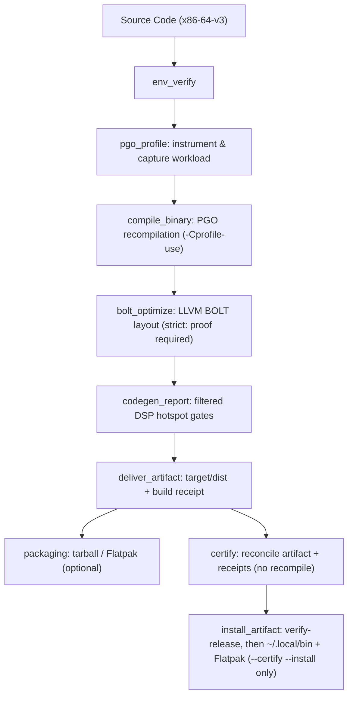

<!--
SPDX-License-Identifier: GPL-3.0-or-later
Copyright (c) 2026 Fábio Henrique de Lima Silva (fhl.bsb@gmail.com) All rights reserved.
-->

# Automated Test Suite & Verification Architecture - `NAM-Audio-Pipe`

This document details the automated testing architecture, verification suites, regression gates, and compiler optimization pipeline for **NAM-Audio-Pipe** ([`../`](../)).

> **Documentation Philosophy**: Source code is the primordial source of truth. This guide does not transcribe implementation details line-by-line; instead, it establishes the testing architecture, explains the *why* behind design invariants, defines critical real-time contracts, and guides developers on running and extending test suites safely.

---

## 1. Scope & Crate Features Taxonomy

`NAM-Audio-Pipe` testing relies on feature flags defined in [`Cargo.toml`](../Cargo.toml):

| Feature Flag       | Purpose                                                                | Operational Scope                                                  |
|:------------------ |:---------------------------------------------------------------------- |:------------------------------------------------------------------ |
| **`default`**      | Enables `dual-mono` by default (`default = ["dual-mono"]`).            | Production builds and baseline compilation checks.                 |
| **`dual-mono`**    | Propagates `NeuralAmpModeler-rs/dual-mono` for stereo L/R processing. | Default feature enabled across standard builds and audio pipelines. |
| **`testing`**      | Propagates `NeuralAmpModeler-rs/testing`, `dual-mono`, `serde`, `sha2`.| Mandatory for executing unit, integration, and verification tests. |
| **`heap-audit`**   | Enables counting allocators to verify 0 heap allocations in RT paths.  | Used in the long suite's `heap-audit` phase and RT callback safety tests. |
| **`rt-hardening`** | Mirrors `NeuralAmpModeler-rs/rt-hardening` for matrix uniformity.      | Unconditionally active in `[dependencies]`; opt-in feature mirror. |

### 1.1 Dependency Graph & Feature Unification Behavior

- **Engine Feature Graph**: In [`Cargo.toml`](../Cargo.toml), `NeuralAmpModeler-rs` is declared with `default-features = false, features = ["rt-hardening"]`. This ensures the engine's `dual-mono` feature is not unconditionally forced by the dependency line.
- **`--no-default-features` Behavior**: When compiled with `--lib --no-default-features` (as tested by `utils/lints.sh`), `dual-mono` is disabled, allowing the lean single-inference mono pipeline while retaining `rt-hardening`.
- **Target Feature Requirements**: Testing binaries (e.g. `pgo_workload`, `pipe_long_receipt`, `ab_opt_bench`) declare `required-features = ["testing"]`. When checking or compiling targets with `--no-default-features`, Cargo skips targets whose required features are not satisfied unless `--features testing` or `--all-features` is supplied.

---

## 2. Automated Test Inventory

The test architecture separates fast unit tests (verifying isolated module contracts) from integration tests (exercising the full audio graph, disk I/O, IPC, and operating system interfaces).

```text
NAM-Audio-Pipe Test Hierarchy
├── Unit Tests (src/...)
│   ├── CLI & Validation           -> Argument parsing, buffer size & gate domains
│   ├── Real-Time Setup & Hardware -> Thread priority, CPU affinity, PM QoS
│   ├── Audio Callback (RT)        -> DSP staging, panic containment, zero-alloc
│   ├── SPSC Resource Swaps        -> Lock-free dynamic model/IR/resampler updates
│   ├── Host FSM & Reconnect       -> Stream state transitions, bounded exponential backoff
│   └── Asynchronous Recording     -> Lock-free slot pool, worker lifecycle, disk serialization
└── Integration Tests (tests/...)
    ├── e2e_cli.rs                 -> Black-box subprocess CLI validation & exit codes
    ├── recording*.rs              -> Bit-exact WAV persistence, fault-injection & io_uring
    ├── pw_integration.rs          -> Live PipeWire context, stream binding & reconnect
    ├── service_resilience.rs      -> POSIX signal bursts, graceful finalization & fail-closed FSM
    ├── stereo_fidelity.rs         -> Bit-identical L/R channel processing & SNR oracles
    ├── swap_stress.rs             -> Multi-producer lock-free swap stress under RT load
    ├── soak_extended.rs           -> Accelerated-timeline soak (320k blocks, RSS stability)
    ├── endurance.rs               -> Real wall-clock endurance (fail-closed validation windows)
    ├── rt_metrics.rs              -> Nanosecond deadline & inter-callback jitter profiling
    └── distribution_qa.rs         -> AppStream XML & dist-binary packaging smoke
```

---

### 2.1 Unit Tests (Module-Level)

Each unit test verifies strict architectural invariants directly within the relevant module:

#### CLI & Argument Parsing

- **Location**: [`src/standalone/cli_test.rs`](../src/standalone/cli_test.rs)
- **Contract**: Parses command-line flags, model/IR paths, gain stages (`[-20.0, +20.0]` dB), oversampling factors, and diagnostic modes (`--diagnose`, `--diagnose-full`).
- **Key Invariants**:
  - **Buffer Size Domain**: Strictly `{0} ∪ {2^k | 16 ≤ 2^k ≤ 8192}`. Valid values (`0, 16, 32, ..., 8192`) are accepted; invalid values (non-powers-of-two, below 16, above 8192) fail fast with a typed `BufferSizeError` before any PipeWire connection.
  - **Silence Gate Domain**: Polymorphic mode handling:
    - Literals `on`/`true`/`default` map to `GateConfig::default_on()` (open at `-70.0 dBFS`, close at `-80.0 dBFS`).
    - Literals `off`/`false`/`0` map to `GateConfig::Off` (linear threshold `0.0`, permanently open FSM).
    - Numeric thresholds `[-96.0, -20.0]` dBFS (with optional `db`/`dbfs` suffix) derive the close threshold via 10 dB Schmitt hysteresis: `close = max(open − 10 dB, −96 dB)`.
    - Positive finite inputs auto-normalize with a logged warning (`60` → `-60.0 dBFS`).
    - Out-of-domain or malformed inputs reject immediately with exit code 2.

#### Real-Time Thread Setup & PM QoS

- **Location**: [`src/standalone/rt_setup/rt_setup_test.rs`](../src/standalone/rt_setup/rt_setup_test.rs), [`src/standalone/rt_setup/pm_qos.rs`](../src/standalone/rt_setup/pm_qos.rs), [`src/standalone/rt_setup/thread.rs`](../src/standalone/rt_setup/thread.rs)
- **Contract**: Configures thread scheduling, CPU affinity, activation precision mode, and power management constraints.
- **Key Invariants**:
  - Interacts with `/dev/cpu_dma_latency` to prevent CPU C-state entry latency spikes during audio streaming.
  - Detects default hardware sinks via `pw-metadata` with a 500 ms watchdog timeout and filters out self-capture loopback nodes.
  - Re-exports core affinity heuristics from the engine's verified `rt_hardening` module.
  - Real-time thread setup explicitly sets thread-local `ActivationPrecision` (`Standard` universal default or `Fast` Padé) on the actual data thread prior to the first DSP quantum, overriding any pre-existing TLS on thread pools or across reconnect cycles.

#### Telemetry & Status Polling

- **Location**: [`src/standalone/rt_setup/telemetry_test.rs`](../src/standalone/rt_setup/telemetry_test.rs)
- **Contract**: Periodically reads atomic bitmasks (`RtStatusFlags`) from the RT thread and publishes throttled off-RT logs.
- **Key Invariants**:
  - **Episode Latches**: Flag and counter signals emit at most once per anomaly episode and re-arm only after the condition clears.
  - **Gate Log Throttling**: Limits gate transition logs to at most one entry per `GATE_LOG_MIN_INTERVAL`, folding rapid chatters into `(×N)` counters.
  - **Diagnostic Format**: Emits concise `[Exxxx | MNEMONIC]` lines without dumping bloated log traces.

#### First-Run Launcher & Terminal Presentation

- **Location**: [`src/standalone/launcher.rs`](../src/standalone/launcher.rs), [`src/standalone/banner.rs`](../src/standalone/banner.rs)
- **Contract**: Controls non-interactive vs interactive execution and terminal UI formatting.
- **Key Invariants**:
  - `startup_mode(args_empty)` exits immediately with code 0 when called without arguments, enforcing a strict non-interactive CLI contract.
  - Interactive pause (`--pause`) prompts for Enter only when standard input is an active TTY.
  - Banner rendering produces deterministic session summaries across all model/IR/rate/quantum configurations, with and without ANSI escape sequences.

#### Shared Memory Bridge

- **Location**: [`src/standalone/pw_host/bridge.rs`](../src/standalone/pw_host/bridge.rs)
- **Contract**: Allocates shared memory for zero-copy lock-free ping-pong transfer between PipeWire capture and playback streams.
- **Key Invariants**: Enforces runtime system page size alignment (supporting 4, 16, and 64 KiB layouts) with full page padding, applies `madvise` memory hints (`MADV_DONTFORK`, `MADV_DONTDUMP`) with explicit diagnostic verification, and verifies atomic generation counter progression in `allocate_dsp_bridge`.

#### PipeWire Capture Stream Setup

- **Location**: [`src/standalone/pw_host/capture/setup_test.rs`](../src/standalone/pw_host/capture/setup_test.rs)
- **Contract**: Builds SPA Pod audio format negotiation objects and stream property dictionaries (`node.latency`, media role, node name).

#### Real-Time Audio Callback & Gain Staging

- **Location**: [`src/standalone/pw_host/rt_callback/process_test.rs`](../src/standalone/pw_host/rt_callback/process_test.rs)
- **Contract**: Executes per-quantum audio processing on the PipeWire real-time thread.
- **Key Invariants**:
  - Zero heap allocation/deallocation on the hot-path (verified under `feature = "heap-audit"`).
  - Handles buffer quantum sizes up to `MAX_BRIDGE_BUF` (8192 frames) without dropping or truncating blocks.
  - Tracks overruns in both blocks and frames (`OVERRUN_COUNT` and `OVERRUN_FRAMES_COUNT`), preserving the reconciliation invariant: `captured_frames == enqueued_frames + lost_frames`.
  - Classifies SPA chunk windows (`Valid`/`Absent`/`Malformed`): corrupt chunks (`SPA_CHUNK_FLAG_CORRUPTED`) or invalid strides raise `RT_STATUS_HOST_CONTRACT_VIOLATION` (E2304) and mute output fail-closed.

#### Real-Time Panic Containment

- **Location**: [`src/standalone/pw_host/rt_callback/mod.rs`](../src/standalone/pw_host/rt_callback/mod.rs)
- **Contract**: Isolates unexpected panics within the RT callback to prevent crashing the host daemon or triggering C-FFI aborts.
- **Key Invariants**:
  - Wraps RT closure bodies in `catch_unwind(AssertUnwindSafe)` once per quantum.
  - On panic, latches the fatal atomic flag `RT_STATUS_PANIC_CAPTURED` (bit 31) and immediately mutes audio.
  - Subsequent callback invocations check the latch via a single `Relaxed` load and exit instantly, preventing repetitive panic loops while awaiting graceful teardown.
  - Release profile inherits `panic = "unwind"`, ensuring unwinding containment remains functional in shipped production artifacts.
  - The control loop treats a captured panic as terminal, bypassing reconnect cycles and performing clean WAV finalization.

#### Lock-Free SPSC Resource Swaps & Rebuild Handlers

- **Location**: [`src/standalone/pw_host/rt_callback/commands.rs`](../src/standalone/pw_host/rt_callback/commands.rs), [`cabsim_swap.rs`](../src/standalone/pw_host/rt_callback/cabsim_swap.rs), [`rate_sync.rs`](../src/standalone/pw_host/rt_callback/rate_sync.rs), [`resampler_swap.rs`](../src/standalone/pw_host/rt_callback/resampler_swap.rs), [`handlers_test.rs`](../src/standalone/pw_host/handlers_test.rs)
- **Contract**: Enables non-blocking, zero-allocation runtime swaps of neural models, cabinet IRs, sample rate converters, and oversampling engines.
- **Key Invariants**:
  - Command rings use bounded SPSC queues. The audio thread drains pending updates without blocking, while old resources are returned to an off-RT garbage collection (GC) queue for safe deallocation.
  - Resampler rebuild generation tracking is strictly idempotent across callbacks while a rebuild is in flight, preserving the target host rate even when atomic swap returns 0.
  - Supports legitimate supersession and immediate unmuting on return to active rate ("retorno à taxa vigente"), invalidating in-flight envelopes.
  - Failure handling is bounded: fail-open rollback un-mutes with the fallback resampler and latches failure state locally to prevent retry/alloc/log storms on unrecoverable rate tuples.

#### Backend State Machine & Fail-Fast SLA

- **Location**: [`src/standalone/pw_host/status_test.rs`](../src/standalone/pw_host/status_test.rs)
- **Contract**: Manages host operational state transitions (`Starting` → `Running` → `Degraded`/`Failed` → `Terminated`).
- **Key Invariants**:
  - **Sticky Failure**: Once marked `Failed`, the state cannot be reverted to `Running` except through a formal reconnection handshake (`begin_reconnect`).
  - **Fail-Fast SLA**: The main control loop observes a stream failure and initiates teardown in under 200 ms.
  - A captured RT panic transitions the backend to `Failed`, allowing clean resource release instead of an abrupt abort.

#### Bounded Reconnection Policy

- **Location**: [`src/standalone/pw_host/reconnect_test.rs`](../src/standalone/pw_host/reconnect_test.rs)
- **Contract**: Implements automated reconnection to the PipeWire daemon when interrupted.
- **Key Invariants**:
  - **Default Policy**: 6 attempts with progressive backoff (250 → 500 → 1000 → 2000 → 4000 → 4000 ms), capped at a total budget of 11,750 ms.
  - **Fail-Fast Mode**: `--fail-fast` sets attempts to 0, terminating immediately on stream disconnect.
  - **Stability Reset**: After 60 seconds (`STABLE_RESET`) of uninterrupted healthy streaming, the attempt budget fully replenishes. Isolated transient drops do not exhaust the retry budget over time.

#### Asynchronous Recording Engine & Guard Lifecycle

- **Location**: [`src/recording/`](../src/recording/)
- **Contract**: Manages lock-free audio capture to disk without blocking the real-time processing thread.
- **Key Invariants**:
  - **RAII Teardown**: `RecordingWorkerGuard` guarantees bounded worker joins, stopping worker threads and flushing headers safely on drop.
  - **Loss Accounting**: If overruns occurred during recording, the process exits with code 6 (`SuccessWithLoss`), detailing lost frames without hiding dropped data.
  - **Memory Subsystem Efficiency**: The promoted `RecordingPool` slot transport reduces memory subsystem traffic by ~57% compared to traditional inline SPSC rings.
  - **Disk Space Transparency**: Periodically queries filesystem headroom, emitting warnings when free space drops below 1 GiB or 5 minutes of remaining audio.

#### PipeWire Log Redirection & Off-RT Log Ring

- **Location**: [`src/standalone/pw_host/log_redirect.rs`](../src/standalone/pw_host/log_redirect.rs), [`rt_log_ring.rs`](../src/standalone/pw_host/rt_log_ring.rs), [`rt_log_mark.rs`](../src/standalone/rt_setup/rt_log_mark.rs)
- **Contract**: Intercepts C-ABI PipeWire logs and routes them safely away from the real-time audio thread.
- **Key Invariants**:
  - Uses a fixed 1024-byte stack buffer with allocation-free UTF-8 conversion.
  - Audio threads marked via TLS (`rt_log_mark`) divert log messages into a pre-allocated SPSC ring (~344 KiB), avoiding blocking `log::*` macros on the audio thread.
  - An off-RT drainer thread consumes the ring and replays messages into the application logger in original order.

#### Signal Handling & Process Lifecycle

- **Location**: [`src/standalone/signals_test.rs`](../src/standalone/signals_test.rs)
- **Contract**: Coordinates POSIX signal handling (`SIGINT`, `SIGTERM`) for graceful process termination.
- **Key Invariants**:
  - Implements a staged 500 ms grace window. Repeated signals within this burst window are coalesced into a single cooperative shutdown.
  - Hard escalation (`_exit(1)`) occurs only if cleanup hangs beyond the 500 ms window.

---

### 2.2 Integration Test Suites ([`tests/`](../tests/))

Integration tests validate full-system behavior against real external interfaces, subprocesses, and filesystems:

```text
tests/
├── e2e_cli.rs                   -> Subprocess CLI smoke tests, argument parsing & exit codes
├── recording.rs                 -> Asynchronous disk writer, zero-sample streams, io_uring
├── recording_fault_injection.rs -> Byte-exact PCM roundtrips, RIFF chunk walker, leak sweeps
├── pw_integration.rs            -> Live PipeWire streaming, tone driver & reconnect cycles
├── service_resilience.rs        -> Real SIGTERM handling, grace windows, fail-closed FSM
├── stereo_fidelity.rs           -> Bit-exact dual-mono vs stereo pipeline equality (SNR > 120 dB)
├── swap_stress.rs               -> Concurrent multi-producer swap bursts under RT load
├── soak_extended.rs             -> Accelerated timeline soak (320k blocks, RSS leak checks)
├── endurance.rs                 -> Wall-clock real-time endurance testing
├── rt_metrics.rs                -> Nanosecond deadline & jitter benchmarking (SCHED_FIFO)
└── distribution_qa.rs           -> AppStream validation & dist-binary packaging smoke
```

#### CLI End-to-End Black-Box Suite

- **File**: [`tests/e2e_cli.rs`](../tests/e2e_cli.rs)
- **Objective**: Validates user-facing CLI behavior by invoking the compiled binary (`CARGO_BIN_EXE_nam-audio-pipe`).
- **Verifications**:
  - Rejection of invalid `--buffer-size` flags (`-b 100`, `-b 1`, `-b 16384`) with clear argument error messages on stderr *before* attempting PipeWire initialization.
  - Rejection of invalid `--gate` modes (`--gate invalid`, `--gate -120`) with exit code 2.
  - Typed exit code classification: missing/corrupt model exits 3 (`Model`), invalid IR exits 4 (`Cab IR`), unreachable PipeWire exits 5 (`PipeWire`), and recording setup failure exits 6 (`Recording`).
  - `--cab-optional` allows startup when `--cab` is missing by issuing a warning and bypassing cabinet simulation.

#### Asynchronous WAV Recording Suite

- **File**: [`tests/recording.rs`](../tests/recording.rs)
- **Objective**: Asserts that `disk_writer_loop` safely drains ring buffers into valid 32-bit float stereo WAV files.
- **Verifications**: Correct RIFF/WAVE header formation, clean zero-sample WAV finalization on immediate stop, discard of uninitialized blocks, fail-fast behavior on unusable output directories, and end-to-end byte-size equality (`data` header chunk matches written PCM bytes). The E2E PipeWire session attaches a silent `pw-play` producer to the host capture sink as soon as the node registers, so a headless graph without a hardware `Audio/Source` still schedules `process()` quantums; the silent WAV is generated once in a dedicated directory outside the capture scan and the producer is killed and reaped by an RAII guard on every exit path.

#### Recording Fault-Injection & Anti-Leak Harness

- **File**: [`tests/recording_fault_injection.rs`](../tests/recording_fault_injection.rs)
- **Objective**: Stress-tests recording persistence under adverse filesystem conditions and abnormal shutdowns.
- **Verifications**:
  - **Independent Chunk Parser**: Validates RIFF structures using an internal chunk walker cross-checked against `hound`.
  - **Bit-Exact Roundtrips**: Verifies sample-by-sample fidelity for sine, deterministic LCG noise, and ramp signals, including mid-stream sample rate changes split into `_partN` files.
  - **Capacity Boundaries**: Persists full 2048, 2049, and 8192-frame quantums without truncation.
  - **Fault Resilience**: Mid-stream disk space exhaustion (`EFBIG`/`ENOSPC`) preserves partial WAV files cleanly up to the fault point.
  - **Resource Leak Sweeps**: Verifies that 100 consecutive start/stop cycles release all file descriptors and threads back to baseline.

#### Live PipeWire Host Pipeline

- **File**: [`tests/pw_integration.rs`](../tests/pw_integration.rs)
- **Objective**: Tests full audio graph execution against an active PipeWire daemon.
- **Verifications**: Context creation, dual-stream setup, parameter injection, real audio execution (`last_n_samples > 0`), and atomic shutdown. Uses an inaudible tone driver to keep the capture node actively scheduled. Includes `#[ignore]` private-daemon disruption tests (`daemon_bounce_*`, run by the long audit) proving automatic recovery after daemon restarts.

#### Service Resilience & Signal Harness

- **File**: [`tests/service_resilience.rs`](../tests/service_resilience.rs)
- **Objective**: Exercises live subprocess termination and degraded stream handling.
- **Verifications**:
  - Sends real `SIGTERM` signals to a running recording process, asserting exit code 0 and 100% valid, closed WAV files.
  - Rapid double-signal bursts within the 500 ms grace window are coalesced into a single graceful exit.
  - Daemon-free tests verify that playback buffer starvation produces exact analytical silence (`0.0f32`), and unsupported SPA audio formats trigger fail-closed muting with typed contract violations (E2304).

#### Stereo Fidelity & Channel Independence

- **File**: [`tests/stereo_fidelity.rs`](../tests/stereo_fidelity.rs)
- **Objective**: Verifies that the stereo DSP pipeline processes left and right channels with complete independence and bit-exact fidelity.
- **Verifications**: Feeds complex test signals (uncorrelated noise, quadrature chirps, Karplus-Strong string synthesis) through both stereo and isolated mono pipelines. Asserts exact bitwise identity (`MSE == 0.0`, `SNR > 120 dB`).

#### Latency Accounting & Oversampling Impulse Peak Alignment

- **Files**: [`tests/oversampling_latency.rs`](../tests/oversampling_latency.rs), [`tests/cabsim_partition_latency.rs`](../tests/cabsim_partition_latency.rs)
- **Objective**: Validates end-to-end DSP latency accounting across CabSim partitions, resampler ratios, and oversampling factors (`Off`, `X2`, `X4`).
- **Verifications**:
  - Offline unit impulse response through `RtSwapHarness` at 48 kHz, 96 kHz, and 44.1 kHz.
  - Published latency from `StreamStatusFlags::read_applied_latencies` matches measured impulse peak index within $\pm 1$ sample tolerance.
  - Zero heap allocation/deallocation on the RT callback thread (`feature = "heap-audit"`).
  - CabSim partition policy strictly shapes output underrun prefix independent of host quantum.

#### Concurrency & Swap Stress Harness

- **File**: [`tests/swap_stress.rs`](../tests/swap_stress.rs)
- **Objective**: Drives the real-time callback under heavy multi-producer concurrent swap load.
- **Verifications**: Floods the SPSC command queues with model reloads, CabSim IR updates, oversampling switches, and gain changes while processing audio. Proves that channel assignments never invert, atomic pairings remain consistent, and zero allocations occur on the audio thread.

#### Accelerated Soak & Wall-Clock Endurance Suites

- **Files**: [`tests/soak_extended.rs`](../tests/soak_extended.rs), [`tests/endurance.rs`](../tests/endurance.rs)
- **Objective**: Certifies memory and state stability over prolonged execution.
- **Verifications**:
  - **Accelerated Soak**: Processes 320,000 continuous audio blocks (~426 seconds of compressed audio) with thousands of concurrent swaps. Asserts zero minor/major page faults on the RT callback thread (`ru_minflt`/`ru_majflt`) and memory drift within OS page margins (< 256 KiB raw `VmRSS` delta). `configure_process_wide` disables glibc heap trimming (`mallopt(M_TRIM_THRESHOLD, -1)`, `M_MMAP_MAX = 0`) so freed arenas are reused instead of returned to the kernel, and swapped CabSim/oversampling engines are pre-touched on the producer thread before publication.
  - **Real Wall-Clock Endurance**: Runs at nominal hardware speed (48 kHz / 64 frames) for a configurable duration (`NAM_ENDURANCE_SECONDS`, default 30 s), asserting fail-closed validation windows and zero descriptor leaks.

#### Nanosecond Real-Time Metrics & Jitter Harness

- **File**: [`tests/rt_metrics.rs`](../tests/rt_metrics.rs)
- **Objective**: Evaluates deterministic execution timing using monotonic clocks (`CLOCK_MONOTONIC_RAW`).
- **Verifications**:
  - **RT Deadline Gate**: 10,000 consecutive quantums under full DSP load (WaveNet + CabSim). Worst-case execution must remain strictly below 85% of quantum budget (`(N/SR) * 10^9 * 0.85`).
  - **RT Jitter Gate**: Measures callback dispersion under thread contention, verifying tail jitter $p99.99 \le 0.75 \cdot T$ on calibrated real-time kernels.
  - **Concurrency Stress**: Validates lock-free state transitions and SPSC throughput across 16 competing threads.

#### Distribution QA Harness

- **File**: [`tests/distribution_qa.rs`](../tests/distribution_qa.rs)
- **Objective**: Certifies shipping metadata and the distributed binary artifact.
- **Verifications**: Strict AppStream XML validation (`io.github.fabiohl.NAMAudioPipe.metainfo.xml`) and stripped production binary smoke tests (`--diagnose`/`--help`). Release receipts and long-audit certification are verified by the release chain, not by this harness.

---

## 3. Verification Scripts & QA Suite (`utils/`)

Executable verification scripts in [`utils/`](../utils/) automate testing across different developer and CI phases:

### 3.1 Static Quality Gate ([`utils/lints.sh`](../utils/lints.sh))

Class A. It runs the following steps in order and aborts on the first failure:

1. **Formatting:** `cargo fmt --all` is applied during local development (N-5); with `CI=true` it only verifies with `--check`.
2. **Compilation matrix:** `cargo check --locked` for all-targets/all-features, lib/no-default-features, and all-targets/no-default-features.
3. **Strict Clippy:** the same matrix with `-- -D warnings`.
4. **Documentation:** `cargo doc --locked --no-deps --all-features` must build. Rustdoc warnings are capped while the pre-existing intra-doc link debt is addressed.
5. **SPDX headers:** every tracked `.rs`, `.sh`, `.py`, `build.rs`, and `Cargo.toml` must carry `GPL-3.0-or-later` or `MIT`.
6. **Text policies:** documented `#[allow(clippy::...)]` suppressions and the centralized `log::set_max_level` rule.
7. **Packaging:** mandatory Flatpak/AppStream/desktop paths, plus `appstreamcli validate --no-net --strict` and `desktop-file-validate`.

### 3.2 Quick Discipline ([`utils/tests-quick.sh`](../utils/tests-quick.sh))

Class A with two invocations in the development profile: `cargo test --locked --features testing --no-fail-fast` (default `dual-mono`) and `cargo test --locked --no-default-features --features testing --no-fail-fast` (lean single-inference path). `#[ignore]` tests are skipped by construction; harnesses that assert per-channel `dual-mono` semantics are `#[cfg(feature = "dual-mono")]` and therefore absent from the lean run instead of producing false failures. The discipline emits `scope=quick`; it never builds release, never provisions infrastructure, never emits receipts, and never applies manual `--skip` lists. It is the suite expected at the end of each sprint and must stay within 5 minutes with a warm cache.

### 3.3 Long Audit Suite ([`utils/tests-long.sh`](../utils/tests-long.sh))

Class B, operator-only. It records every phase result instead of aborting on the first failure, runs all `#[ignore]` product suites in release, and, with `--artifact`, binds the machine-readable receipt to the exact SHA-256 of `target/dist/nam-audio-pipe`.

> [!CAUTION]
> **Human Operator Exclusive:** AI agents may inspect `--help` but must never execute this suite.

`--strict` promotes any `GAP` to `FAIL` and exports `NAM_RT_STRICT=1`; `NAM_PHASE_TIMEOUT_S` overrides the timeout used by every phase command. The phases are:

| Receipt `phase_id` | Canonical phase | Harness & Invariant Evaluated | Output Log File |
| :------------------ | :--------------- | :-------------------------------------------------------------------------------------------------------------------------- | :------------------------------------- |
| **`phase0`** | `catch-all` | `cargo test --locked --features testing --release --no-fail-fast` (non-ignored: `e2e_cli`, `distribution_qa`, `stereo_fidelity`, `--lib`). | `target/logs/long-catch-all.log` |
| **`phase1`** | `soak` | `tests/soak_extended.rs` (320k blocks, compressed timeline) + `tests/swap_stress.rs`; asserts stable RSS. RT-thread page faults are `GAP:rt_thread_page_faults` under non-strict hosted QA and hard failures under `--strict`. | `target/logs/long-soak.log` |
| **`phase2`** | `heap-audit` | `cargo test --locked --features "testing heap-audit" --release` over `--lib` and `tests/swap_stress.rs`; asserts zero heap allocations on RT paths. | `target/logs/long-heap-audit.log` |
| **`phase3`** | `rt-deadline` | `tests/rt_metrics.rs` (`deadline`, 10k quantums, DSP load < 85% of the quantum budget; `SCHED_FIFO` when available). | `target/logs/long-rt-deadline.log` |
| **`phase4`** | `rt-jitter` | `tests/rt_metrics.rs` (`jitter`, 10k callbacks under contention; certified absolute wakeup delay, lost cycles, and dispatch dispersion; PASS strictly on isolated CPU). | `target/logs/long-rt-jitter.log` |
| **`phase5`** | `concurrency` | `tests/rt_metrics.rs` (`concurrent`; 16 threads racing swap requests, stream transitions, and SPSC rings without deadlocks). | `target/logs/long-concurrency.log` |
| **`phase6`** | `endurance` | `tests/endurance.rs` (real timeline at 48 kHz/64 frames, `NAM_ENDURANCE_SECONDS`; fail-closed validation windows and zero leaks). RT-thread page faults are `GAP:rt_thread_page_faults` under non-strict hosted QA and hard failures under `--strict`. | `target/logs/long-endurance.log` |
| **`phase7`** | `pw-resilience` | `tests/pw_integration.rs` against a private daemon; asserts reconnection and exhaustion handling. | `target/logs/long-pw-resilience.log` |
| **`phase8`** | `pw-live` | Live daemon + `pw-play` + `io_uring` capability probe, then `tests/pw_integration.rs` and `tests/service_resilience.rs` (`SIGTERM`/double-signal acceptances). Under `--strict` it runs through the same pinned `SCHED_FIFO` RT launcher as `phase3`/`phase4`, so the E2E tight gate can certify on a calibrated host; non-strict runs keep the natural host affinity. An absent capability is a typed GAP; the tests fail closed if executed without it. | `target/logs/long-pw-live.log` |
| **`phase9`** | `recording` | `io_uring_probe` and live PipeWire capability gates, then `tests/recording.rs` and `tests/recording_fault_injection.rs` (`--ignored`); a probe tool/build failure is a phase failure, not a GAP. | `target/logs/long-recording.log` |
| **`phase10`** | `offline-parity` | `tests/pipe_offline_parity.rs` plus `--diagnose` on the canonical artifact when `--artifact` is used. Every case is compared against the in-process f64 oracle; when `NAM_CORE_RENDER_BIN` is provisioned it is also compared against the NAMCore C++ oracle. Preflight validates `NAM_CORE_RENDER_BIN`: if unset or not executable, a typed `offline_parity:missing_cpp_oracle` GAP is recorded with guidance to export the render binary (since the engine is an external dependency from crates.io without local `build/namcore_render/`), avoiding test panics (`rc=101`). When provisioned under `--strict`, `NAM_REQUIRE_CPP_ORACLE=1` is exported. The receipt counts each case/oracle row from the explicit `TEST_RESULT[...]` markers. | `target/logs/long-offline-parity.log` |

Every phase writes `target/logs/long-<name>.log`. The human-readable text receipt is `target/logs/long-receipt.txt` and the typed JSONL receipt is `target/logs/long-audit-receipt.jsonl`.

`--only <name>[,<name>]` accepts only canonical phase names. It preserves `target/long` and writes `target/logs/long-audit-receipt.partial.jsonl` (with `long-receipt.partial.txt` and the sibling partial fail-reasons file); it never deletes the previous full `long-audit-receipt.jsonl`. Non-selected phases are recorded as `SKIPPED`, no overall line is written, and the text receipt ends with `OVERALL: PARTIAL (--only: recibo sem overall, não certificável)` — or `OVERALL: FAILED` if any selected phase failed. A partial receipt is not certifiable. Without `--only`, `target/long` is removed and the receipt can be summarized and certified. After a full run, `pipe_long_receipt validate [--strict]` verifies the JSONL; strict failures now require the typed `reason` emitted for FAILED phases. While recording a deselected phase, the `pipe_long_receipt append` exit code `10` (`LongPhaseStatus::Skipped`) is accepted as success; any other non-zero code marks the receipt as failed. The `only-subset:` gap joins the selected phase names with `+` and carries no embedded spaces, so the gap list remains a single comma-delimited token.

#### 3.3.1 Hosted CI and Manual Long Workflow (GitHub Actions)

- **`ci.yml`:** lints and quick run as separate jobs per platform (`x86_64-linux-lints`, `x86_64-linux-quick`, `linux-arm64-lints`, `linux-arm64-quick`), so a lint failure cannot suppress the functional evidence, plus the `msrv` check (which validates `--locked --all-targets --all-features`). Sibling checkout ref is pinned deterministically via [`variables.env`](../variables.env) (`ENGINE_COMMIT`), and every `Load environment variables` step fails closed when `ENGINE_COMMIT` is empty after sourcing the file. The x86_64 jobs are blocking; the ARM64 lint job is blocking and the ARM64 quick job remains `continue-on-error` (advisory) pending D1 approval. The 2026-11-06 native aarch64 run passed the quick suite, but a single run is not treated as a stability gate; the job summary publishes the advisory note explicitly. The `msrv` cargo-check step uses the canonical `utils/_lib.sh` lifecycle (`lib_init`, `run_step`, `finish`), producing the five-column `target/logs/msrv-status.tsv` carrier (`scope=full`) through the same code path as every other discipline. Each job, including `msrv`, writes `target/logs/ci-provenance.log` (`PHASE: provenance sha=… package_version=… engine_type=… engine_version=… engine_checksum=… auxiliary_engine=… rustc=… cargo=…`) and uploads `target/logs/**` (including the `*-status.tsv` carriers) with `if: always()`.
- **Provenance & Auxiliary Checkout:** each job writes `target/logs/ci-provenance.log` (`PHASE: provenance sha=… package_version=… engine_type=… engine_version=… engine_checksum=… auxiliary_engine=… rustc=… cargo=…`). The compiled engine provenance is extracted deterministically from `Cargo.lock` (`NeuralAmpModeler-rs` version `2.0.0` from crates.io with its locked SHA-256 checksum), distinguishing it from the auxiliary sibling checkout (`$GITHUB_WORKSPACE/NeuralAmpModeler-rs`), which is maintained for parity oracles, reference fixtures, and fallback models pinned by SHA in [`variables.env`](../variables.env). When the sibling is absent, the line records `auxiliary_engine=GAP:sibling_absent` while the compiled engine provenance remains valid and traceable.
- **`long.yml`:** `workflow_dispatch` only, operator-triggered, **zero inputs**: the GitHub "Run workflow" button always uses the single recommended configuration. `timeout-minutes: 300`. Hosted runs provision BOLT and perf (`llvm-bolt`, `linux-tools`, `kernel.perf_event_paranoid=1`), the C++ parity oracle (`NeuralAmpModeler-rs/utils/setup-third-party.sh` + `ensure_namcore_render.sh`, exported as `NAM_CORE_RENDER_BIN` with `NAM_REQUIRE_CPP_ORACLE=1`), and run the fixed hosted-safe phase list `catch-all,soak,heap-audit,concurrency,endurance,pw-resilience,pw-live,recording,offline-parity`; `rt-deadline` and `rt-jitter` are reserved for the operator's isolated host. The hosted build is **never** invoked with `--strict`: that flag belongs to the operator release ceremony and requires `target/logs/ab-opt-ceremony-receipt.json`. A capability preflight records `target/logs/ci-capabilities.log` (`io_uring`, `pipewire`, `pw-play`, C++ oracle) before the build, so missing hosted capabilities are visible before any QA claim. Sibling engine checkout is pinned via `variables.env`. The workflow starts a private D-Bus session bus, `pipewire` and `wireplumber` in the same `XDG_RUNTIME_DIR`, and creates persistent `ci-null-sink` (`Audio/Sink`) and `ci-null-source` (`Audio/Source/Virtual`) adapter nodes via `pw-cli create-node`. The step fails closed if `wireplumber` exits or never connects (`application.name = "WirePlumber"` must appear in `pw-cli ls Client`) and unless both nodes appear in `pw-cli ls Node`. The always-on evidence manifest (`target/logs/evidence-manifest.json`) records `build_receipt`, `long_receipt_scope` (`full`/`partial`/`none`) and `certification_receipt`, so a failed build cannot be mistaken for a long audit. Receipt and log upload enforces `if-no-files-found: error`. The workflow never certifies and never rehearses certification; the operator runs `build-release.sh --certify` on the isolated host.
- **Fidelity ownership (`D1`):** `docs/quality-contract.json` and `utils/quality-dashboard.sh` belong to the upstream engine (`NeuralAmpModeler-rs`); this repository has no local copy. Downstream fidelity and oracle parity are validated by the parity tests executed in `utils/tests-long.sh` (`catch-all` and `offline-parity`, plus the C++ `NAMCore` oracle when `NAM_CORE_RENDER_BIN` is provisioned).

### 3.4 Real-Time Criterion Bench

The orphan `utils/tests-performance-regression.sh` wrapper was removed (D-03). [`benches/rt_gate.rs`](../benches/rt_gate.rs) remains available for operator-run Criterion measurements of the RT harness; it is not part of the quick or long disciplines.

- **Diagnostic Manifest**: [`benches/rt_gate.manifest`](../benches/rt_gate.manifest) declares the operator scenario groups (`PIPE_Host/*`, `PIPE_AbOpt/*`); it is not consumed by an automated gate.
- **Baseline Storage**: Baselines, when an operator keeps them, live in `.performance-baselines/` (gitignored) and are never updated automatically. Historical baselines prior to un-feedback `iter_batched_ref` input re-presentation are strictly incomparable.

---

### 3.5 Manual Desktop Environment Checklist (E-04)

Because desktop environments (GNOME, KDE Plasma, XFCE) handle terminal emulators differently, GUI launcher behavior is validated via a manual checklist after Flatpak installation:

1. **No-Argument Launch**: Launch *NAM Audio Pipe* from the application menu. Expected: Displays usage instructions and exits immediately with code 0.
2. **Bypass Action**: Trigger the *Run in bypass (no model)* action. Expected: Audio streams dry with real-time pass-through.
3. **Diagnostics Action**: Trigger the *Diagnostics* action. Expected: Diagnostic bundle is printed and the terminal remains open until Enter is pressed (`--diagnose --pause`).
4. **Non-Blocking Redirection**: Execute `nam-audio-pipe </dev/null | cat` in a terminal. Expected: Prints help text and exits immediately without blocking.
5. **Flatpak Recording**: Launch with `--record`. Expected: Audio captures save to `$XDG_MUSIC_DIR/NAM-Audio-Pipe` without filesystem permission errors.

---

### 3.6 Empirical Calibration & Evidence Registry (E-01…E-04)

The following empirical measurements require physical hardware calibration by a human operator:

| ID   | Measured Item                                               | Calibration Procedure                                                                 | Status |
|:---- |:----------------------------------------------------------- |:------------------------------------------------------------------------------------- |:------ |
| E-01 | Full-suite test receipts                                    | Operator executes `./utils/tests-long.sh` and submits `target/logs/long-receipt.txt`. | Open   |
| E-02 | WAV finalization latency for 1 GiB capture on SSD / HDD     | Measured via `recording_ab_bench`; documented as `// Measured: finalize=... ms`.      | Open   |
| E-03 | PipeWire daemon resurrection latency (p95 over 20 restarts) | Measured by restarting PipeWire; adjusts reconnect budget if $p95 > 10\text{ s}$.     | Open   |
| E-04 | Desktop launcher integration across desktop environments    | Executed via manual checklist in §3.5.                                                | Open   |

---

### 3.7 Host Memory Protection (Operator-Owned)

The repository never hardcodes compiler parallelism and never re-executes itself under a memory limiter:

- **Parallelism** is controlled exclusively from the host shell profile (`~/.bashrc`), for example by exporting `CARGO_BUILD_JOBS` on memory-constrained machines. No script and no `.cargo/config.toml` sets a default.
- **Heavy release/PGO builds** may be wrapped by the operator in a host-level cgroup limiter. Containment is an external, opt-in decision; the QA disciplines do not provision it.
- **IDE protection**: lowering the IDE process `oom_score_adj` (requires privileges) keeps the kernel from targeting the editor before compiler workers.

---

## 4. Build & Release Chain ([`utils/build-release.sh`](../utils/build-release.sh))

`NAM-Audio-Pipe` employs a multi-stage Profile-Guided Optimization (PGO) and LLVM BOLT pipeline to maximize cache locality and execution speed. The build discipline **only builds**: it never runs tests, and it always deposits the canonical artifact at `target/dist/nam-audio-pipe` with `target/dist/build-receipt.json`.



### 4.0 Release Chain

The operator (or the external release ceremony) runs exactly three steps:

1. `./utils/build-release.sh --strict [--package]` — builds and emits `build-receipt.json`. `--strict` validates `target/logs/ab-opt-ceremony-receipt.json` in `env_verify` and fails before PGO/BOLT when the operator proof is absent or invalid; the hosted `long.yml` therefore never passes `--strict` to the build. Building never installs anything. With `--package`, Flatpak initializes an empty build directory before staging application files; initialization errors are recorded in `target/logs/build-release-packaging.log`.
2. `./utils/tests-long.sh --strict --artifact` — audits the canonical artifact and binds every receipt line to its SHA-256.
3. `./utils/build-release.sh --certify --install` — hashes the artifact again, reconciles the build and long receipts, and writes `target/dist/release-receipt.json` with `CERTIFIED` or `REJECTED`. It never recompiles. Only after `certify PASS`, `--install` runs `pipe_long_receipt verify-release` (status `CERTIFIED`, artifact SHA-256, build/long receipt reconciliation, package paths), installs `target/dist/nam-audio-pipe` atomically into `~/.local/bin` with the verified SHA-256 re-checked, and runs `flatpak install --user --reinstall` only when the release receipt declares a `flatpak_path`. The phase is `PHASE: install_artifact PASS log=target/logs/build-release-install_artifact.log`. `--install` without `--certify` exits 2.

The external release ceremony runs `./utils/ab-opt-ceremony.sh` before step 1 when it is present; its typed receipt (`target/logs/ab-opt-ceremony-receipt.json`) is the BOLT win proof consumed by `build-release.sh --strict`. Step 2 performs a preflight check for the C++ oracle (`NAM_CORE_RENDER_BIN`); because the engine is a crates.io dependency, its in-registry `render_bin_path()` fallback has no `build/namcore_render/` tree, so the operator must export `NAM_CORE_RENDER_BIN`. If missing, `offline-parity` records a typed GAP `offline_parity:missing_cpp_oracle` and prints the export guidance without panicking.

#### C++ Oracle Setup Procedure (Operator & CI)

The offline parity suite (`tests/pipe_offline_parity.rs`) validates fidelity against the C++ NAMCore reference oracle whenever `NAM_CORE_RENDER_BIN` is exported. Because `NAM-Audio-Pipe` consumes `NeuralAmpModeler-rs` as a crate dependency from crates.io, the local repository contains no vendored `build/namcore_render/` tree.

- **Hosted CI:** The GitHub Actions workflow automatically provisions the sibling checkout and compiles the oracle via [`variables.env`](../variables.env) and `utils/ensure_namcore_render.sh`, exporting `NAM_CORE_RENDER_BIN` with `NAM_REQUIRE_CPP_ORACLE=1`.
- **Local Host (Once per Machine):** The operator compiles the oracle once in the engine checkout:

  ```bash
  (cd ~/NAM/NeuralAmpModeler-rs && utils/setup-third-party.sh && utils/ensure_namcore_render.sh)
  ```

- **Operator Session (Before Running Long Suite or Release Ceremony):** Export the oracle path into the shell session:

  ```bash
  export NAM_CORE_RENDER_BIN="$(cd ~/NAM/NeuralAmpModeler-rs && utils/ensure_namcore_render.sh | tail -n1)"
  ```

- **Fail-Closed Preflight:** If `NAM_CORE_RENDER_BIN` is not exported or not executable, Phase 10 (`offline-parity`) gracefully skips execution with typed GAP `offline_parity:missing_cpp_oracle` and prints the exact export command. Under `--strict`, the gap halts certification fail-closed without an unhandled panic (`rc=101`).

> **Optimization pipeline:** Under `--strict` mode, `build-release.sh` enforces Profile-Guided Optimization (PGO) and, on BOLT-capable hosts (`llvm-bolt` plus either `merge-fdata` or `perf2bolt` with `kernel.perf_event_paranoid <= 1`), post-link machine code reordering to maximize real-time performance.

### 4.0 A/B Optimization Ceremony & Promotion Policy

The A/B optimization ceremony (`utils/ab-opt-ceremony.sh` and `pipe_ab_opt compare`) evaluates DSP cycles across all canonical topologies (`wavenet_a1`, `wavenet_a2`, `lstm`) over at least 3 measured runs. The promotion rule operates on median `p99` cycles per topology with an explicit 1.0% margin (`PROMOTION_MARGIN_PCT = 1.0%`):

- **`PGO-ONLY`**: Satisfied when, for **all** topologies `t`:
  $$\text{median}(p99_{\text{pgo}}[t]) \le \text{median}(p99_{\text{plain}}[t]) \times (1 - 0.010)$$
- **`PGO+BOLT`**: Satisfied when `PGO-ONLY` holds **and**, for **all** topologies `t`:
  $$\text{median}(p99_{\text{bolt}}[t]) \le \text{median}(p99_{\text{pgo}}[t]) \times (1 - 0.010)$$
- **`UNOPTIMIZED`**: In all other cases (e.g. margin not met on any topology, or `coverage_incomplete`).

#### PGO-ONLY Fallback Policy & BOLT Promotion

In accordance with release policy P1, BOLT is applied during release assembly (`utils/build-release.sh`) **only** when accompanied by a ceremony proof linked to the exact commit yielding the `PGO+BOLT` verdict.

When the ceremony proves `PGO-ONLY` with BOLT applied (`bolt_applied=true`, PGO achieves the >=1.0% margin across all topologies, but BOLT fails to beat PGO by >=1.0% on every topology, `verdict_reason=bolt_margin_not_met`):

1. `build-release.sh` detects `PGO-ONLY` automatically via `pipe_long_receipt ceremony-proof`.
2. It is not a gap: it emits `PHASE: bolt_optimize PASS log=...`, sets `bolt_status=not_proven` and `bolt_proof=fallback_pgo_only` in the build receipt (which lists `bolt_not_proven` as informative; the typed strict check does not treat it as blocking).
3. Profiling and host paranoid adjustments are bypassed, and the build proceeds with the optimized PGO binary.
4. Under `--strict`, `build-release.sh` finishes with `PASS` and delivers the certified binary without failure.

A `PGO-ONLY` ceremony receipt whose BOLT was not applied (`bolt_applied=false`, e.g. missing tools or PipeWire, or BOLT not run) is rejected by the typed validator as `ceremony_bolt_failed`: under `--strict` the build fails before packaging; without `--strict` it degrades to the `bolt_not_proven` gap with an unverified proof.

Blocking matrix under `--strict` (`STRICT=1` in `_lib.sh` `finish`): any GAP fails the run, except the informative `bolt_not_proven` proven fallback above. `bolt_not_applied`, `bolt_tools_unavailable`, `perf_paranoid_not_restored` and `pgo_not_applied` remain blocking GAPs; a missing or rejected ceremony proof fails.
5. In `--certify`, `evaluate_certification` accepts `PGO-ONLY` with the same architectural rigor, recording `verdict="PGO-ONLY"` in `release-receipt.json`.

Metrics `max` and `mean` cycles are recorded and reported per topology for diagnostic analysis but do not alter the promotion verdict, preventing isolated interrupt or preemption spikes on single blocks from rejecting reproducible optimization gains. Aggregated metrics across mixed topologies are deprecated in favor of the authoritative `topologies` block.

#### Signal Convention (`gain_pct` vs. `improvement_pct`)

The ceremony measures **cycles**, not throughput: fewer cycles is the improvement. Both directions must be read with the same sign rule:

- `gain_pct = (novo − antigo) / antigo × 100` — **negative = melhoria** (menos ciclos).
- `improvement_pct = (antigo − novo) / antigo × 100` — positive = improvement; promotion requires `improvement_pct ≥ 1.0%` on every topology (equivalently `gain_pct ≤ −1.0%`).
- Example (2026-11-06): `BOLT gain p99=-0.65%` is a 0.65% improvement, below the 1.0% margin, so BOLT is applied but the verdict is `PGO-ONLY` (`bolt_proof=fallback_pgo_only`).

#### Provenance & Fail-Closed Linkage

The ceremony receipt records comprehensive provenance linking the measurements to the exact commit and machine state:

- `provenance`: `git_sha`, `git_dirty`, `cargo_lock_sha256`, `rustc_vv_sha256`, `engine_commit`, `run_id`, `proof_subject=ab_opt_bench`, `ts`, `cpu_bench`, `isolated`, `governor`, `perf_event_paranoid_before`, `perf_event_paranoid_after`.
- `bolt_lbr`: `samples` (counted from `perf script -F brstack`), `fdata_sha256` (SHA-256 of `perf.fdata`), and `mode` (`lbr` or `basic`).

During release assembly, `build-release.sh` strictly enforces verifiable linkage against the current tree:

- **`ceremony_stale_commit`**: Rejected if `receipt.provenance.git_sha` does not match the current commit (`HEAD`).
- **`ceremony_dirty_tree`**: Rejected if `receipt.provenance.git_dirty` is `true`.
- **`ceremony_lock_mismatch`**: Rejected if `receipt.provenance.cargo_lock_sha256` does not match the current `Cargo.lock` checksum.
- **`verdict_not_optimized`**: Rejected if the verdict is neither `PGO+BOLT` nor `PGO-ONLY`.
- **`ceremony_bolt_failed`**: Rejected if the verdict is `PGO-ONLY` but `bolt_applied` is not `true`.
- Missing receipt under `--strict`: Fails closed immediately (DP-3), preventing silent degradation to `UNOPTIMIZED`.

#### Host Hygiene & Sysctl Restoration

Profiling with hardware branch counters (`perf record -j any,u` or LBR) requires unprivileged access (`kernel.perf_event_paranoid <= 1`). Both `utils/ab-opt-ceremony.sh` and `utils/build-release.sh` maintain strict host hygiene:

1. The pre-ceremony value of `/proc/sys/kernel/perf_event_paranoid` is captured before any elevation (`sudo -n sysctl -w kernel.perf_event_paranoid=1`).
2. Upon completion, failure or script exit (`finish` and `trap EXIT`), the original value is automatically restored.
3. If restoration fails (e.g. `sudo -n` unavailable or sysctl error), a typed gap `perf_paranoid_not_restored` is recorded into the carrier and summary.
4. The ceremony receipt provenance explicitly records `perf_event_paranoid_before` and `perf_event_paranoid_after`, ensuring the host is never left in profiling mode without opt-in.

### 4.1 PGO Workload Coverage Matrix

During Phase 2, `src/bin/pgo_workload.rs` executes a comprehensive training matrix across all DSP kernels:

| Matrix Dimension     | Evaluated Values                   | Weight Distribution                  |
|:-------------------- |:---------------------------------- |:------------------------------------ |
| **Sample Rates**     | 44.1 kHz, 48.0 kHz, 96.0 kHz       | 25% / 50% / 25%                      |
| **Quantum Sizes**    | 32, 64, 128, 256, 512, 1024 frames | 10% / **40%** / 15% / 20% / 10% / 5% |
| **Model Topologies** | WaveNet A1, WaveNet A2, LSTM       | Equal (33.3% each)                   |
| **Oversampling**     | Off, 2×, 4×                        | 60% / 20% / 20%                      |
| **Cabinet IR**       | Enabled (Convolution), Bypass      | 70% / 30%                            |
| **Noise Gate**       | Enabled, Disabled                  | 50% / 50%                            |
| **Recording Pool**   | Enabled, Disabled                  | 50% / 50%                            |

The workload generates `target/logs/pgo-workload-receipt.json`, verifying that every model topology processes at least 1,000 blocks and no DSP stage is skipped.

### 4.2 Static Assembly & Microarchitectural Gates (Phase 4.5)

After BOLT layout optimization, `utils/dsp-hotpath-filter.py` analyzes the disassembled hot-path (`target/logs/codegen/dsp_hotpath.asm`, mirrored to `target/dsp_hotpath.asm`), enforcing strict static architectural rules with explicit status verification and target-by-target coverage ([`utils/codegen-profile.json`](../utils/codegen-profile.json)):

- **Target-by-target coverage**: Tracks mandatory presence for `capture_dsp_pipeline`, `playback_dsp_cycle`, `process_dsp_buffer`, `process_block_internal`, `tanh_and_accumulate`, `cabsim_adapter`, `conv_engine`, and `resampler`, alongside explicitly documented optional/inlined routines (`gated`, `latency_histogram`). Under PGO, LLVM inlines the capture closure's `call_once` adapter, so the `capture_dsp_pipeline` entry accepts the direct `setup_capture_stream::{closure#2}::{closure#0}` symbol while still matching both the streaming and named variants.
- **Fail-closed disassembly & status verification**: Captures `objdump` exit status explicitly, rejecting empty or partial disassembly before running filter gates. The `dsp-hotpath-filter.py` stdout/stderr is captured through `tee -a` into `target/logs/build-release-codegen_report.log`, and disassembly artifacts are preserved in `target/logs/codegen/` for CI artifact upload; any non-zero code (disassembly, empty output, or filter gate) aborts the build instead of degrading to a `GAP`. A missing `objdump` is the only condition that reports the typed `codegen_objdump_unavailable` gap.
- **Zero AVX-512 `zmm` registers, EVEX extended vectors and opmasks**: Enforces baseline `x86-64-v3` compatibility (detects `zmm`, `xmm16`-`xmm31`, `ymm16`-`ymm31`, opmasks `%k[0-7]`, `{z}`, `{1toN}`).
- **Zero `libm` calls in RT paths**: Prohibits scalar standard library math calls in audio loops.
- **Zero `alloc` / `__rust_alloc` symbols**: Prohibits heap allocation in DSP kernels.
- **Atomic artifact delivery & fail-closed certification**: `deliver_artifact` validates each step (`cp`, `strip`, `chmod`, `--diagnose`) before publishing to `target/dist/`; `certify` evaluates both the verifier exit status (`PIPESTATUS[0]`) and log capture (`PIPESTATUS[1]`).

### 4.3 Automated Optimization Pipeline (PGO & Post-Link BOLT)

Production builds execute a multi-stage optimization pipeline combining Profile-Guided Optimization (PGO) and LLVM BOLT. Compilation begins by instrumenting DSP kernels with profiling counters; the synthetic workload exercises all canonical channel counts, sample rates, and quantum matrices. The resulting profile guides branch layout, function inlining, and loop vectorization in the second pass. On BOLT-capable hosts, post-link basic block reordering (`--reorder-blocks=ext-tsp`) and function placement (`--reorder-functions=hfsort`) are applied with `-hugify` and function splitting to minimize I-Cache and I-TLB miss penalties on critical DSP cycles.

The `pgo_profile` phase chains `pgo_workload`, `pgo-check`, the `.profraw` count check, profile merge and the non-empty merged-profile check with `&&`. Any failure removes the PGO directory and aborts the release build: `pgo_workload` is deterministic internal code, so a partial profile can never be accepted. A host without `llvm-profdata` reports the typed `pgo_profdata_unavailable` gap and skips PGO instead of claiming a false `PASS`. When BOLT tooling is absent, `env_verify` emits `bolt_tools_unavailable` once and `bolt_optimize` does not duplicate it with `bolt_not_applied`; the latter is reserved for a BOLT-capable host where the optimization itself could not be applied. Every completed build phase (`env_verify`, `pgo_profile`, `compile_binary`, `bolt_optimize` when applied, `codegen_report`, `deliver_artifact`, `packaging`, `build_receipt`; `install_artifact` after `certify`) emits its canonical `PHASE: <name> PASS log=<path>` line.

BOLT selects its profiling strategy from the host capabilities. Bare-metal hosts with hardware LBR keep `perf record -j any,u` followed by `perf2bolt`; hosted VMs that expose no LBR entries switch to BOLT instrumentation (`llvm-bolt -instrument` → workload → `merge-fdata`), which needs no PMU counters and is the preferred path whenever `merge-fdata` is present. When `merge-fdata` is unavailable, the sampled profile is still converted by `perf2bolt -nl` (no-LBR mode). A profile with fewer than 500 samples, a mismatched build ID, or a non-representative fdata set fails the phase; under `--strict` it aborts the build. This mirrors the instrumented strategy already validated on the `NAM-Plug` hosted runner.

---

## 5. Developer Workflow & Execution Guide

All test commands must be executed from the root of the `./NAM-Audio-Pipe/` repository:

### 5.1 Utility Scripts Reference

| Script                         | Primary Responsibility                                                                 | Target Audience / Frequency    |
|:------------------------------ |:-------------------------------------------------------------------------------------- |:------------------------------ |
| **`utils/lints.sh`**           | Class A: formatting applied (verified in CI), check/clippy matrix, doc, SPDX, text policies, packaging. | Continuous / Every commit |
| **`utils/tests-quick.sh`**     | Class A: dev-profile `cargo test --features testing` plus `--no-default-features --features testing` (lean mono), skipping `#[ignore]`. | End of sprint                  |
| **`utils/tests-long.sh`**      | Class B: 10-phase audit (soak, zero-alloc, RT, endurance, live PipeWire, io_uring, f64 parity). | Operator / Nightly / Release |
| **`utils/build-release.sh`**   | Class C: builds the PGO/BOLT artifact and receipt; `--certify` reconciles without recompiling. | Production releases |
| **`utils/miri-audit.sh`**      | Class D: out-of-band formal aliasing and data-race audit for lock-free rings.          | Maintenance / Unsafe code audit |

### 5.2 Direct Command Cheat Sheet

```bash
# -----------------------------------------------------------------------------
# 1. Static Quality Gate
# -----------------------------------------------------------------------------
./utils/lints.sh

# -----------------------------------------------------------------------------
# 2. Quick Discipline (development profile, non-ignored targets)
# -----------------------------------------------------------------------------
./utils/tests-quick.sh

# -----------------------------------------------------------------------------
# 3. Unit tests only
# -----------------------------------------------------------------------------
cargo test --features testing --lib

# -----------------------------------------------------------------------------
# 4. CLI end-to-end black-box tests
# -----------------------------------------------------------------------------
cargo test --features testing --test e2e_cli

# -----------------------------------------------------------------------------
# 5. Live PipeWire integration (requires a running daemon)
# -----------------------------------------------------------------------------
cargo test --features testing --release --test pw_integration -- --ignored --nocapture

# -----------------------------------------------------------------------------
# 6. Asynchronous recording integration (io_uring)
# -----------------------------------------------------------------------------
cargo test --features testing --release --test recording -- --ignored --nocapture

# -----------------------------------------------------------------------------
# 7. Distribution QA & packaging audit
# -----------------------------------------------------------------------------
cargo test --features testing --test distribution_qa

# -----------------------------------------------------------------------------
# 8. Release chain (human operator only): build -> long audit -> certify
# -----------------------------------------------------------------------------
./utils/build-release.sh --strict --package
./utils/tests-long.sh --strict --artifact
./utils/build-release.sh --certify --install
```

```

---

## 6. Architectural Contracts & Quality Gates

The following contractual rules are enforced across test suites and CI checks:

| Quality Gate                | Target Contract / Boundary Threshold                                                                                                       | Enforcement Location                                       |
|:--------------------------- |:------------------------------------------------------------------------------------------------------------------------------------------ |:---------------------------------------------------------- |
| **Real-Time Memory Safety** | Exactly 0 heap allocations / deallocations in the RT callback.                                                                             | Verified under `feature = "heap-audit"`                    |
| **Lock-Free Concurrency**   | Zero mutex locks or blocking system calls on the audio thread.                                                                             | Architecture review & static analysis                      |
| **WAV Header Integrity**    | Finalized WAV `data` chunk header size must match the exact PCM payload bytes written to disk.                                             | `tests/recording.rs`, `tests/recording_fault_injection.rs` |
| **Buffer Size Domain**      | Strictly `{0} ∪ {2^k \| 16 ≤ 2^k ≤ 8192}`. Out-of-domain inputs reject fail-fast with typed `BufferSizeError`.                             | `src/standalone/cli.rs`, `tests/e2e_cli.rs`                |
| **Silence Gate Domain**     | Polymorphic mode: `on`/`off` or `[-96.0, -20.0]` dBFS threshold with 10 dB Schmitt hysteresis. Rejected fail-fast on malformed inputs.     | `src/standalone/cli.rs`, `tests/e2e_cli.rs`                |
| **RT Quantum Bounds**       | Maximum supported quantum is `MAX_BRIDGE_BUF` (8192 frames / 32,768 bytes). Larger descriptors reject fail-closed.                         | `src/standalone/pw_host/rt_callback/process.rs`            |
| **RT Deadline Processing**  | Worst-case processing per quantum must be < 85% of quantum budget `(N/SR)` over 10,000 quantums.                                           | `tests/rt_metrics.rs`, `utils/tests-long.sh` (`rt-deadline` phase)     |
| **Target CPU Baseline**     | Strictly `x86-64-v3` (AVX2, FMA, BMI2). No scalar runtime fallbacks.                                                                       | `.cargo/config.toml`                                       |
| **AppStream XML Validity**  | Metainfo parses under strict XML; exactly one `<release>` tag matching `CARGO_PKG_VERSION` with a valid `date`; id/name/launchable align with the desktop entry. | `tests/distribution_qa.rs`, `utils/lints.sh`, `utils/build-release.sh` |
| **Release Provenance**      | `target/dist/build-receipt.json` records the artifact SHA-256, git provenance, engine provenance from `Cargo.lock` and PGO/BOLT evidence; `release-receipt.json` records `CERTIFIED`/`REJECTED`. | `src/receipt/build.rs`, `src/receipt/release.rs`, `utils/build-release.sh` |

---

### 6.1 Out-of-Band Miri Concurrency & Aliasing Audit

Standard builds and CI pipelines use the stable Rust toolchain. To formally verify pointer provenance and absence of data races under the Stacked Borrows and Tree Borrows models, an out-of-band Miri script is provided:

```bash
# Optional manual verification (requires nightly toolchain + miri):
./utils/miri-audit.sh
```

**Miri Audit Scope**:

1. **`src/recording/pool_test.rs` (`RecordingPool`)**: 13/13 tests pass under Miri, verifying lock-free SPSC ring ordering and atomic descriptor ownership without data races.
2. **`src/standalone/pw_host/pw_host_test.rs` (`test_dsp_bridge_concurrent_access`)**: Exercises the shared ping-pong memory bridge under concurrent writer and reader threads. `DspBridge::buffers` wraps storage in `UnsafeCell`, accessing payloads through raw pointers to avoid invalid whole-struct retags.
3. **Exclusions**: Full neural network SIMD evaluation kernels are excluded from Miri due to vector intrinsic emulation overhead (~10,000× slowdown).

---

## 7. Script Contract & Automation Disciplines

All automation scripts in `utils/` follow a lean, predictable contract designed for deterministic automation, reproducible CI, and transparent developer workflows.

### 7.1 Script Classes & Error Handling

| Class | Scripts | Error Handling | Rationale |
| :----- | :------- | :-------------- | :--------- |
| **Class A — Interactive** | `lints.sh`, `tests-quick.sh` | `set -euo pipefail`; aborts on the first failure; `ERR` trap emits `RESULT: FAIL` | Real-time developer loops; immediate failure conserves cycles. |
| **Class B — Decoupled Audit** | `tests-long.sh` | `set -o pipefail` (no `-e`, no `-u`); every phase records its status; exit `1` at the end if any phase failed | Nightly/pre-release audits must collect all phase evidence without aborting. |
| **Class C — Build** | `build-release.sh` | `set -euo pipefail`; aborts on the first failure | An intermediate build failure invalidates all downstream artifacts. |
| **Class D — Manual Tool** | `miri-audit.sh`, `mod-update.sh` | `set -euo pipefail` | Operator-supervised, opt-in tools. |

### 7.2 Output Protocol & Exit Codes

1. **Phase announcement:** `PHASE: <phase_name>`
2. **Phase completion:** `PHASE: <phase_name> PASS|FAIL|GAP ... log=<path>`
3. **Unified final line:** `RESULT: PASS|PASS_WITH_GAPS|FAIL (<seconds>s) fails=<comma-list|none> gaps=<comma-list|none> scope=<full|partial>`
4. **Exit codes:** `0` success or `PASS_WITH_GAPS` outside strict mode; `1` failure or a gap under `--strict`; `2` usage error or missing precondition.

Detailed logs go to `target/logs/<script>-<phase>.log` through `tee`; the long suite uses `target/logs/long-<name>.log`. The canonical `PHASE:`/`RESULT:` lines are also appended to `target/logs/summary.txt` and published by the local `.github/actions/qa-summary` composite action; the ARM CI job now invokes `utils/lints.sh` (with the packaging dependencies installed) instead of an inline clippy command. The quick discipline never emits receipts; the long discipline emits the JSONL receipt consumed by the release chain.

### 7.2.1 Evidence Lifecycle (`utils/_lib.sh`)

`utils/_lib.sh` is a pure definition file: sourcing it has no side effects. Every script parses `-h`/`--help` and rejects unknown flags **before** calling `lib_init`, so help never destroys evidence. `lib_init` is the single point that creates `target/logs`, resolves `NAM_RUN_ID` (honoring a pre-exported value, as CI does per run/attempt), truncates `target/logs/summary.txt` only when a pre-exported run id differs from `target/logs/.summary-run` (a locally generated id never truncates: it accumulates and prints a `RUN: <id>` marker line before the phases), and removes the script's own stale carrier. `utils/build-release.sh` writes `target/logs/build-run-id` after a successful build; `utils/tests-long.sh` reuses it when `NAM_RUN_ID` is not pre-exported, so the three local release commands reconcile. A discipline invoked as a child inside another discipline's phase sets `lib_quiet=1`, which suppresses its writes to `summary.txt`: the parent's verdict can never be replaced by a child's `PASS`.

- **One RESULT per invocation.** Every path — success, phase failure, unexpected error (`ERR` trap → `trap_fail`), usage error — terminates with exactly one `RESULT:` line and exit codes `0`/`1`/`2` as above.
- **Typed status carrier.** Each `finish` writes `target/logs/<script>-status.tsv`: one line, five TAB-separated columns — `<discipline>\t<PASS|PASS_WITH_GAPS|FAIL>\t<gaps|none>\t<fails|none>\t<scope=full|scope=partial>` (lists comma-separated). A partial selection (`--only`) records `scope=partial` without counting as a GAP; certification (`utils/build-release.sh --certify`) strictly rejects partial scope. A carrier write failure forces `FAIL` and appends `carrier` to the fails list; a missing or invalid carrier is never treated as success. `summary.txt` remains the human/AI-readable record, not the decision source.
- **GAP grammar.** Gap markers follow `PHASE: <phase_name> GAP <technical_reason>`, emitted by the `gap` helper with the current `PHASE_NAME`.
- **Write failures are failures.** `emit` records a failed `summary.txt` append in `EMIT_RC` without returning error (a `return 1` would escape the ERR trap under `set -e` and abort with neither `RESULT` nor carrier); `finish` then downgrades the verdict to `FAIL`, rewrites the carrier with `fails=emit` and prints a single `RESULT: FAIL`. `run_step` captures both `PIPESTATUS[0]` (the producer) and the `tee` status. Neither path can silently report `PASS`.

### 7.3 Core Automation Principles

- **No tests of test tooling:** suites validate the audio product (DSP, inference, PipeWire host, CLAP/standalone CLI, packaging). Meta-tests over scripts, receipt schemas, or internal QA tools are forbidden.
- **Quick never provisions:** `tests-quick.sh` uses only fixtures and tooling already present; it never clones, downloads, or builds release artifacts.
- **Long collects all failures:** `tests-long.sh` completes every preflight and phase, aggregating passes, gaps, and failures without early termination.
- **Convention over parameterization:** defaults are the host's natural behavior (all cores, zero thermal cooldown, unpinned). Variables only override.
- **Scripts stay self-contained:** no relative references to sibling repositories and no `source` outside the repository; shell logic is minimal and typed policy lives in Rust binaries.

### 7.4 Canonical Command-Line Flags

| Script | Supported Flags | Notes |
| :------ | :--------------- | :----- |
| **All scripts** | `-h`, `--help` | Concise usage; exit 0. |
| `lints.sh` | None | Zero-flag policy; formatting is applied locally and verified with `CI=true`. |
| `tests-quick.sh` | None | No gap-allowance or simulation flags. |
| `tests-long.sh` | `--strict`, `--artifact`, `--only <name>[,<name>]` | `--strict` turns any `GAP` into `FAIL`; `--artifact` binds the receipt to `target/dist/nam-audio-pipe`; `--only` selects canonical phases and yields a partial, non-certifiable receipt. |
| `build-release.sh` | `--strict`, `--package`, `--install`, `--certify` | `--package` adds tarball/Flatpak; `--certify` validates receipts without recompiling; `--install` is valid only with `--certify` and installs the verified artifact (and the declared Flatpak bundle). |
| `miri-audit.sh`, `mod-update.sh` | None | Manual tools. |

### 7.5 Canonical Environment Variables

#### Interface Variables (User & CI Control)

| Variable | Default | Scope | Purpose & Semantics |
| :-------- | :------- | :----- | :------------------- |
| `CI` | Unset | CI runner | When `true`, `lints.sh` verifies formatting with `--check` instead of applying it. |
| `NAM_THERMAL_COOLDOWN_S` | `0` | Performance test | Non-negative integer seconds between benchmark runs. An invalid value exits `2`. |
| `NAM_BENCH_CORE` | `auto` | A/B / RT | Bench-core precedence: explicit CPU → first online isolated CPU → first permitted CPU → unpinned `GAP`. |
| `NAM_PHASE_TIMEOUT_S` | Per-command default | `tests-long.sh` | Overrides the timeout applied to each long-audit phase command. |
| `NAM_ENDURANCE_SECONDS` | Harness default | `tests/endurance.rs` | Wall-clock endurance window. |
| `NAM_CORE_RENDER_BIN` | Unset | `tests/pipe_offline_parity.rs` | Absolute path to the NAMCore C++ render binary; when set, the offline parity cases are also compared against the C++ oracle. |

#### Harness Variables (Internal Script → Rust Communication)

| Variable | Configured By | Read By | Purpose |
| :-------- | :------------- | :------- | :------- |
| `NAM_RUN_ID` | `utils/_lib.sh` | Test harnesses | Unique run identifier for logs and receipt isolation. |
| `NAM_RT_STRICT` | `tests-long.sh --strict` | `tests/rt_metrics.rs` | Promotes RT GAP conditions to hard failures. |
| `NAM_REQUIRE_CPP_ORACLE` | `tests-long.sh --strict` / hosted workflow | `tests/pipe_offline_parity.rs` | Makes a missing NAMCore C++ render binary a hard failure instead of a silent f64-only run. |

### 7.6 Measured Durations

| Discipline / Script | Measured Duration | Budget Ceiling | Notes |
| :------------------- | :----------------- | :-------------- | :----- |
| `utils/lints.sh` | ≈13 s (warm cache, 2026-10-27) a ≈20 s | ≤ 2 min | fmt + check/clippy matrix + doc + SPDX + policies + packaging. |
| `utils/tests-quick.sh` | ≈90–120 s (warm cache, two dev-profile passes) | ≤ 5 min | All non-ignored targets in the development profile, dual-mono and lean mono. |
| `utils/tests-long.sh` | Not measured (per-phase timeouts) | — | Operator-run; collects all failures. |
| `utils/build-release.sh` | ≈204 s (PGO-only reference run) | — | Full BOLT time depends on the host toolchain and `perf` permissions. |

#### QA footprint (métrica F-2, 2026-10-27)

`wc -l`: shell **1.502**, py/awk **362**, Rust QA (`src/bin/*`) **6.024** →
**7.888 linhas** de QA total. O bin órfão `long_receipt_check` (39 linhas) foi
removido; os demais bins têm chamador ou são instrumento manual documentado.

---

## 8. References

- [NAM-Audio-Pipe Architecture](architecture.md) — Comprehensive threading model, host lifecycle, and memory layout.
- [`NeuralAmpModeler-rs`](https://github.com/fabiohl/NeuralAmpModeler-rs) — Agnostic neural DSP engine.
- [PipeWire Official Documentation](https://docs.pipewire.org/) — Linux audio graph daemon and SPA API reference.
